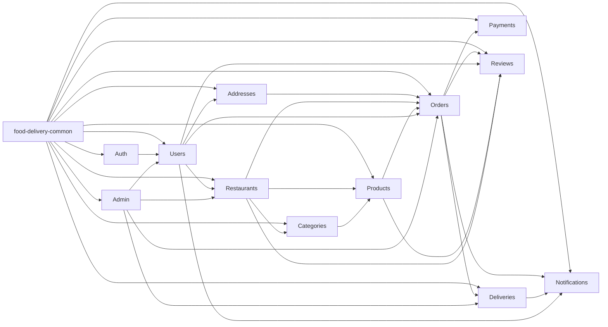
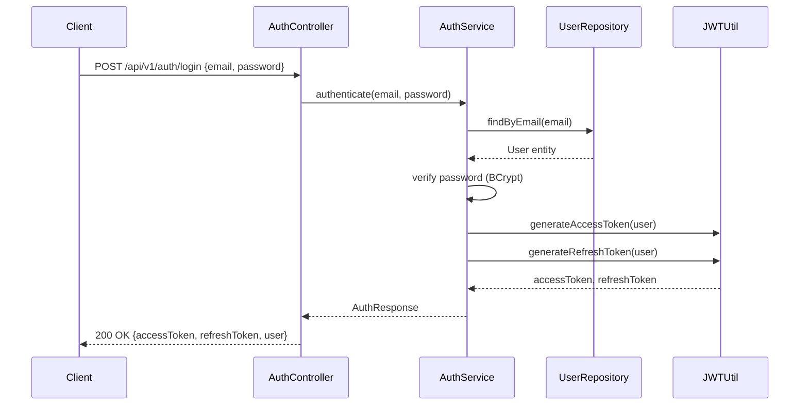
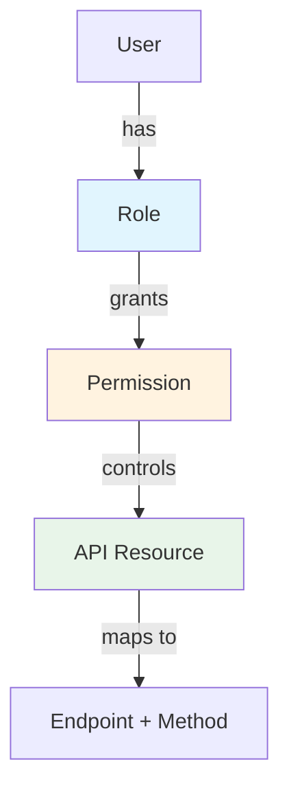
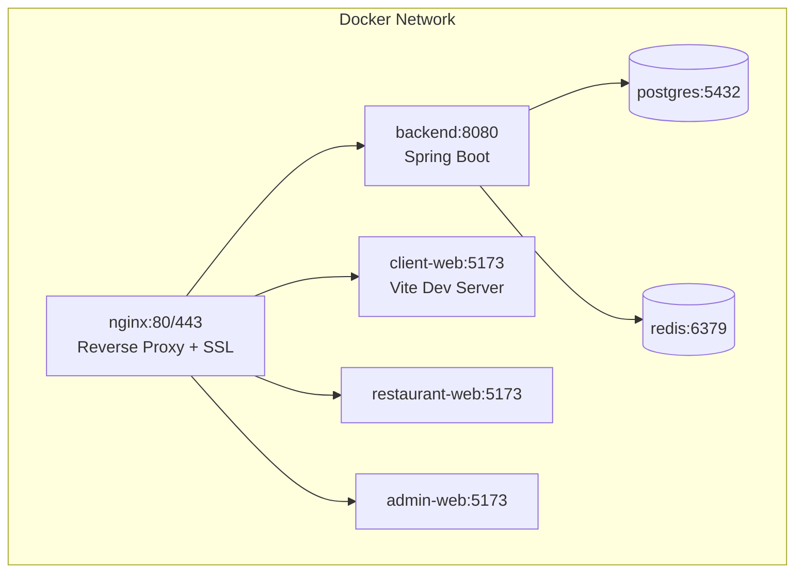

# Architecture Documentation

## Project: Food Delivery Platform

**Version:** 1.0  
**Date:** 2026-11-19  
**Status:** PHASE 0 - Proposed Architecture (Pending Approval)

---

## 1. System Overview

The Food Delivery Platform is a **modular monolithic** backend serving four distinct frontend applications through a unified REST API (with future WebSocket extensions). The architecture follows domain-driven design principles with clear separation of concerns.

### High-Level Architecture

```mermaid
graph TB
    subgraph "Frontend Applications"
        ClientApp[📱 Client Mobile<br/>Kotlin + Jetpack Compose]
        DeliveryApp[📱 Delivery Mobile<br/>Kotlin + Jetpack Compose]
        RestaurantWeb[🌐 Restaurant Web<br/>React + TypeScript + Vite]
        AdminDashboard[🌐 Admin Dashboard<br/>React + TypeScript + Vite]
    end

    subgraph "API Gateway / Load Balancer"
        APIGateway[API Gateway<br/>nginx / Spring Cloud Gateway]
    end

    subgraph "Backend - Modular Monolith"
        AuthModule[🔐 Authentication Module]
        UserModule[👥 Users Module]
        RestaurantModule[🏪 Restaurants Module]
        CategoryModule[📂 Categories Module]
        ProductModule[🍔 Products Module]
        AddressModule[📍 Addresses Module]
        OrderModule[📦 Orders Module]
        DeliveryModule[🚚 Deliveries Module]
        PaymentModule[💳 Payments Module]
        NotificationModule[🔔 Notifications Module]
        ReviewModule[⭐ Reviews Module]
        AdminModule[⚙️ Administration Module]
    end

    subgraph "Data Layer"
        PostgreSQL[(PostgreSQL<br/>Primary Database)]
        Redis[(Redis<br/>Cache / Sessions / WebSocket)]
        FileStorage[📁 File Storage<br/>Images / Documents]
    end

    subgraph "External Services"
        FCM[Firebase Cloud Messaging]
        EmailService[Email Service]
        SMSService[SMS Service]
    end

    ClientApp --> APIGateway
    DeliveryApp --> APIGateway
    RestaurantWeb --> APIGateway
    AdminDashboard --> APIGateway

    APIGateway --> AuthModule
    APIGateway --> UserModule
    APIGateway --> RestaurantModule
    APIGateway --> CategoryModule
    APIGateway --> ProductModule
    APIGateway --> AddressModule
    APIGateway --> OrderModule
    APIGateway --> DeliveryModule
    APIGateway --> PaymentModule
    APIGateway --> NotificationModule
    APIGateway --> ReviewModule
    APIGateway --> AdminModule

    AuthModule --> PostgreSQL
    UserModule --> PostgreSQL
    RestaurantModule --> PostgreSQL
    CategoryModule --> PostgreSQL
    ProductModule --> PostgreSQL
    AddressModule --> PostgreSQL
    OrderModule --> PostgreSQL
    DeliveryModule --> PostgreSQL
    PaymentModule --> PostgreSQL
    NotificationModule --> PostgreSQL
    ReviewModule --> PostgreSQL
    AdminModule --> PostgreSQL

    AuthModule --> Redis
    OrderModule --> Redis
    DeliveryModule --> Redis
    NotificationModule --> Redis

    NotificationModule --> FCM
    NotificationModule --> EmailService
    NotificationModule --> SMSService

    RestaurantModule --> FileStorage
    ProductModule --> FileStorage
    UserModule --> FileStorage
```



---

## 2. Backend Architecture - Modular Monolith

### Module Structure

```
backend/
├── food-delivery-parent/          # Parent POM
├── food-delivery-auth/            # Authentication & Authorization
├── food-delivery-users/           # User management
├── food-delivery-restaurants/     # Restaurant management
├── food-delivery-categories/      # Category management
├── food-delivery-products/        # Product management
├── food-delivery-addresses/       # Address management
├── food-delivery-orders/          # Order management
├── food-delivery-deliveries/      # Delivery management
├── food-delivery-payments/        # Payment management
├── food-delivery-notifications/   # Notification management
├── food-delivery-reviews/         # Review management
├── food-delivery-admin/           # Administration
├── food-delivery-common/          # Shared utilities, DTOs, exceptions
└── food-delivery-api/             # OpenAPI specification (generated)
```

### Module Dependencies



### Layered Architecture (per module)

```
src/main/java/com/fooddelivery/{module}/
├── controller/          # REST Controllers (API endpoints)
├── service/             # Business logic (transactional)
├── repository/          # Spring Data JPA repositories
├── domain/              # JPA Entities
├── dto/                 # Request/Response DTOs
├── mapper/              # Entity <-> DTO mapping
├── exception/           # Module-specific exceptions
├── validator/           # Custom validators
└── config/              # Module configuration
```

---

## 3. Technology Stack Summary

| Layer | Technology | Version |
|-------|------------|---------|
| Language | Kotlin | 1.9+ |
| Framework | Spring Boot | 3.2+ |
| Security | Spring Security + JWT | 6.2+ |
| Data Access | Spring Data JPA + Hibernate | 3.2+ |
| Database | PostgreSQL | 16+ |
| Migrations | Flyway | 10+ |
| Documentation | Springdoc OpenAPI | 2.3+ |
| Testing | JUnit 5 + Mockito + Testcontainers | 5.10+ |
| Build | Gradle (Kotlin DSL) | 8.5+ |
| Cache/Session | Redis | 7+ |
| Messaging | WebSocket (STOMP) + FCM | - |
| Containerization | Docker + Docker Compose | - |

---

## 4. Security Architecture

### Authentication Flow



### Authorization Model



**Roles:**
- `ROLE_CUSTOMER`
- `ROLE_DELIVERY_PERSON`
- `ROLE_RESTAURANT_OWNER`
- `ROLE_ADMIN`

**Permission Examples:**
- `ORDER_CREATE` - Create orders
- `ORDER_READ_OWN` - Read own orders
- `ORDER_READ_ALL` - Read all orders (admin)
- `RESTAURANT_MANAGE_OWN` - Manage owned restaurants
- `RESTAURANT_APPROVE` - Approve restaurant applications (admin)
- `DELIVERY_ASSIGN` - Assign deliveries (admin)
- `USER_MANAGE` - Manage users (admin)

---

## 5. API Design Principles

### REST Conventions

| Resource | Convention |
|----------|------------|
| Base Path | `/api/v1` |
| Collections | Plural nouns: `/restaurants`, `/orders` |
| Members | `/restaurants/{id}`, `/orders/{id}` |
| Sub-resources | `/restaurants/{id}/products`, `/orders/{id}/items` |
| Actions | Custom endpoints: `/orders/{id}/accept`, `/deliveries/{id}/pickup` |

### Standard Response Format

```json
{
  "success": true,
  "data": {},
  "meta": {
    "timestamp": "2026-11-19T10:30:00Z",
    "requestId": "uuid"
  }
}
```

### Error Response Format

```json
{
  "success": false,
  "error": {
    "code": "VALIDATION_ERROR",
    "message": "Invalid input data",
    "details": [
      {"field": "email", "message": "Email is required"}
    ]
  },
  "meta": {
    "timestamp": "2026-11-19T10:30:00Z",
    "requestId": "uuid"
  }
}
```

### Pagination

```
GET /api/v1/restaurants?page=0&size=20&sort=name,asc
```

Response:
```json
{
  "content": [...],
  "pageable": {"pageNumber": 0, "pageSize": 20, "sort": {"sorted": true}},
  "totalElements": 150,
  "totalPages": 8,
  "first": true,
  "last": false,
  "numberOfElements": 20
}
```

---

## 6. Data Consistency & Transactions

### Transaction Boundaries

| Operation | Transaction Scope |
|-----------|-------------------|
| Order Creation | Order + OrderItems + Payment (pending) + Inventory check |
| Order Acceptance | Order status + OrderStatusHistory + Notification |
| Delivery Assignment | Delivery + Order status + DeliveryPerson availability |
| Payment Processing | Payment + Order status + Notification |
| Restaurant Approval | Restaurant status + User role assignment + Notification |

### Optimistic Locking

All entities with concurrent modification risk use `@Version` field:

```kotlin
@Version
private var version: Long = 0
```

---

## 7. Caching Strategy

| Data | Cache TTL | Invalidation |
|------|-----------|--------------|
| Restaurant list (public) | 5 min | On restaurant update/approval |
| Restaurant menu | 10 min | On product/category change |
| User profile | 30 min | On profile update |
| Order status (active) | 30 sec | On status change |
| Delivery person location | 10 sec | Real-time updates |

---

## 8. Observability

### Logging
- Structured JSON logging (Logback + Logstash encoder)
- Correlation IDs via `X-Request-ID` header
- Log levels: ERROR, WARN, INFO, DEBUG

### Metrics (Micrometer + Prometheus)
- HTTP request latency, count, error rate
- Database connection pool usage
- Cache hit/miss ratios
- Business metrics: orders/min, avg delivery time

### Distributed Tracing
- OpenTelemetry + Jaeger (future phase)

---

## 9. Deployment Architecture (Docker Compose)



---

## 10. Key Architectural Decisions

| Decision | Rationale |
|----------|-----------|
| Modular monolith over microservices | Simpler deployment, transactions, debugging; can extract later |
| JWT stateless auth | Horizontal scaling, no session affinity needed |
| UUID primary keys | Distributed ID generation, no enumeration attacks |
| Flyway migrations | Version-controlled schema, reproducible environments |
| DTOs never expose entities | Security, API stability, serialization control |
| Optimistic locking | Prevent lost updates without database locks |
| Centralized exception handling | Consistent error responses, easier debugging |
| OpenAPI-first contracts | Frontend/backend parallel development |

---

## 11. Scalability Considerations

1. **Stateless backend** - Horizontal scaling via load balancer
2. **Read replicas** - For reporting/analytics queries
3. **Redis clustering** - For session/cache scaling
4. **WebSocket** - Sticky sessions or Redis-backed message broker
5. **Database partitioning** - Orders by date (future)
6. **CDN** - For static assets (images, frontend bundles)

---

## 12. Open Questions for Confirmation

1. **Mobile Platform** - Native Android only? iOS planned?
2. **Image Storage** - Local MinIO/S3? Cloud provider preference?
3. **Email/SMS Provider** - SendGrid, AWS SES, Twilio, other?
4. **Production Deployment** - Kubernetes? Cloud Run? VMs?
5. **Monitoring Stack** - Prometheus/Grafana? Datadog? Cloud provider?
6. **Multi-region** - Single region initially?
7. **Data Retention** - GDPR/privacy requirements?
8. **Rate Limiting** - Per-user? Per-IP? Adaptive?

---

*This architecture document will be updated as the project evolves. All implementation must align with these principles.*