# Database Design

## Project: Food Delivery Platform

**Version:** 1.0  
**Date:** 2026-11-19  
**Status:** PHASE 0 - Proposed (Pending Approval)

---

## 1. Conceptual Data Model (ER Diagram)

```mermaid
erDiagram
    USER ||--o{ CUSTOMER_PROFILE : has
    USER ||--o{ DELIVERY_PROFILE : has
    USER ||--o{ RESTAURANT_OWNER_PROFILE : has
    USER ||--o{ ADDRESS : owns
    USER ||--o{ NOTIFICATION : receives
    USER ||--o{ ORDER : places
    USER ||--o{ REVIEW : writes
    
    RESTAURANT_OWNER_PROFILE ||--o{ RESTAURANT : owns
    RESTAURANT ||--o{ RESTAURANT_HOURS : has
    RESTAURANT ||--o{ CATEGORY : has
    RESTAURANT ||--o{ ORDER : receives
    RESTAURANT ||--o{ REVIEW : receives
    
    RESTAURANT_APPLICATION ||--|| RESTAURANT : creates
    
    CATEGORY ||--o{ PRODUCT : contains
    PRODUCT ||--o{ REVIEW : receives
    PRODUCT ||--o{ ORDER_ITEM : referenced_in
    
    CUSTOMER_PROFILE ||--o{ ORDER : places
    CUSTOMER_PROFILE ||--o{ REVIEW : writes
    
    ORDER ||--|{ ORDER_ITEM : contains
    ORDER ||--o{ ORDER_STATUS_HISTORY : tracks
    ORDER ||--o| DELIVERY : has
    ORDER ||--o| PAYMENT : has
    ORDER ||--o{ REVIEW : generates
    
    DELIVERY_PROFILE ||--o{ DELIVERY : handles
    DELIVERY ||--o{ DELIVERY_LOCATION_UPDATE : tracks
    DELIVERY_PROFILE ||--o{ REVIEW : receives
    
    ADDRESS }|--o{ ORDER : "delivery_address (snapshot)"
    ADDRESS }|--o{ DELIVERY : "pickup/delivery address"
    
    RESTAURANT }|--o{ ORDER : "restaurant snapshot"
    
    USER {
        uuid id PK
        string email UK
        string password_hash
        string first_name
        string last_name
        string phone
        string avatar_url
        enum role
        enum status
        boolean email_verified
        string email_verification_token
        string password_reset_token
        datetime password_reset_expires
        int failed_login_attempts
        datetime locked_until
        datetime last_login_at
        datetime created_at
        datetime updated_at
        long version
    }
    
    CUSTOMER_PROFILE {
        uuid id PK
        uuid user_id FK,UK
        uuid default_address_id FK
        json preferences
        int loyalty_points
        datetime created_at
        datetime updated_at
    }
    
    DELIVERY_PROFILE {
        uuid id PK
        uuid user_id FK,UK
        enum vehicle_type
        string vehicle_plate
        string vehicle_color
        string license_number
        date license_expiry
        string id_document_url
        enum background_check_status
        boolean is_available
        decimal current_latitude
        decimal current_longitude
        datetime last_location_update
        decimal average_rating
        int total_deliveries
        datetime created_at
        datetime updated_at
    }
    
    RESTAURANT_OWNER_PROFILE {
        uuid id PK
        uuid user_id FK,UK
        string business_name
        string tax_id
        string bank_account_iban
        string bank_account_name
        decimal commission_rate
        datetime created_at
        datetime updated_at
    }
    
    RESTAURANT {
        uuid id PK
        uuid owner_id FK
        string name
        string slug UK
        string description
        string phone
        string email
        string logo_url
        string cover_image_url
        string cuisine_type
        enum status
        uuid address_id FK
        decimal delivery_radius_km
        decimal minimum_order_amount
        decimal delivery_fee
        int preparation_time_minutes
        decimal average_rating
        int total_reviews
        boolean is_open_now
        string rejection_reason
        datetime approved_at
        uuid approved_by FK
        datetime created_at
        datetime updated_at
        long version
    }
    
    RESTAURANT_HOURS {
        uuid id PK
        uuid restaurant_id FK
        enum day_of_week
        time open_time
        time close_time
        boolean is_closed
        datetime created_at
        datetime updated_at
    }
    
    RESTAURANT_APPLICATION {
        uuid id PK
        uuid owner_id FK
        string proposed_name
        string proposed_cuisine
        uuid proposed_address_id FK
        string business_license_url
        string tax_id_document_url
        string owner_id_document_url
        enum status
        string review_notes
        uuid reviewed_by FK
        datetime reviewed_at
        datetime submitted_at
        datetime created_at
        datetime updated_at
    }
    
    ADDRESS {
        uuid id PK
        uuid user_id FK
        string label
        string street
        string building
        string floor
        string apartment
        string city
        string state
        string postal_code
        string country
        decimal latitude
        decimal longitude
        string instructions
        boolean is_default
        enum address_type
        datetime created_at
        datetime updated_at
    }
    
    CATEGORY {
        uuid id PK
        uuid restaurant_id FK
        string name
        string description
        string image_url
        int display_order
        boolean is_active
        datetime created_at
        datetime updated_at
        long version
    }
    
    PRODUCT {
        uuid id PK
        uuid restaurant_id FK
        uuid category_id FK
        string name
        string description
        decimal price
        string image_url
        string[] additional_images
        boolean is_available
        boolean is_vegetarian
        boolean is_vegan
        boolean is_gluten_free
        string allergens
        string[] tags
        int preparation_time_minutes
        int display_order
        decimal average_rating
        int total_reviews
        datetime created_at
        datetime updated_at
        long version
    }
    
    ORDER {
        uuid id PK
        string order_number UK
        uuid customer_id FK
        uuid restaurant_id FK
        uuid address_id FK
        enum status
        decimal subtotal
        decimal tax_amount
        decimal delivery_fee
        decimal discount_amount
        decimal total_amount
        string customer_notes
        string restaurant_notes
        int estimated_preparation_minutes
        int estimated_delivery_minutes
        datetime confirmed_at
        datetime preparing_at
        datetime ready_at
        datetime picked_up_at
        datetime delivered_at
        datetime cancelled_at
        string cancellation_reason
        uuid cancelled_by FK
        string idempotency_key UK
        datetime created_at
        datetime updated_at
        long version
    }
    
    ORDER_ITEM {
        uuid id PK
        uuid order_id FK
        uuid product_id FK
        string product_name_snapshot
        decimal unit_price_snapshot
        int quantity
        string notes
        decimal line_total
        datetime created_at
        datetime updated_at
    }
    
    ORDER_STATUS_HISTORY {
        uuid id PK
        uuid order_id FK
        enum from_status
        enum to_status
        uuid changed_by FK
        string change_reason
        json metadata
        datetime created_at
    }
    
    DELIVERY {
        uuid id PK
        uuid order_id FK,UK
        uuid delivery_person_id FK
        enum status
        uuid pickup_address_id FK
        uuid delivery_address_id FK
        decimal pickup_latitude
        decimal pickup_longitude
        decimal delivery_latitude
        decimal delivery_longitude
        string pickup_code
        string delivery_code
        string pickup_photo_url
        string delivery_photo_url
        string customer_signature_url
        decimal distance_km
        int estimated_duration_minutes
        int actual_duration_minutes
        datetime assigned_at
        datetime accepted_at
        datetime picked_up_at
        datetime delivered_at
        datetime created_at
        datetime updated_at
        long version
    }
    
    DELIVERY_LOCATION_UPDATE {
        uuid id PK
        uuid delivery_id FK
        decimal latitude
        decimal longitude
        decimal accuracy
        decimal speed
        decimal heading
        datetime recorded_at
    }
    
    PAYMENT {
        uuid id PK
        uuid order_id FK,UK
        decimal amount
        enum method
        enum status
        string transaction_reference
        json gateway_response
        datetime paid_at
        datetime refunded_at
        string refund_reason
        datetime created_at
        datetime updated_at
        long version
    }
    
    NOTIFICATION {
        uuid id PK
        uuid user_id FK
        enum type
        string title
        string message
        json data
        enum priority
        boolean is_read
        datetime read_at
        boolean sent_via_push
        boolean sent_via_email
        boolean sent_via_sms
        datetime created_at
    }
    
    REVIEW {
        uuid id PK
        uuid order_id FK
        uuid customer_id FK
        enum target_type
        uuid target_id
        int rating
        string comment
        string owner_response
        datetime owner_response_at
        boolean is_verified
        enum moderation_status
        datetime created_at
        datetime updated_at
    }
```



---

## 2. PostgreSQL Logical Schema (DDL)

### 2.1 Extensions & Types

```sql
-- Enable required extensions
CREATE EXTENSION IF NOT EXISTS "uuid-ossp";
CREATE EXTENSION IF NOT EXISTS "pgcrypto";
CREATE EXTENSION IF NOT EXISTS "btree_gin";

-- Custom enum types
CREATE TYPE user_role AS ENUM (
    'CUSTOMER', 'DELIVERY_PERSON', 'RESTAURANT_OWNER', 'ADMIN'
);

CREATE TYPE user_status AS ENUM (
    'ACTIVE', 'INACTIVE', 'SUSPENDED', 'PENDING_VERIFICATION', 'DELETED'
);

CREATE TYPE restaurant_status AS ENUM (
    'DRAFT', 'PENDING_APPROVAL', 'APPROVED', 'REJECTED', 'SUSPENDED', 'CLOSED'
);

CREATE TYPE application_status AS ENUM (
    'SUBMITTED', 'UNDER_REVIEW', 'APPROVED', 'REJECTED'
);

CREATE TYPE address_type AS ENUM (
    'HOME', 'WORK', 'OTHER', 'RESTAURANT', 'PICKUP', 'DELIVERY'
);

CREATE TYPE order_status AS ENUM (
    'PENDING', 'ACCEPTED', 'REJECTED', 'PREPARING', 'READY',
    'ASSIGNED', 'PICKED_UP', 'DELIVERING', 'DELIVERED', 'CANCELLED'
);

CREATE TYPE delivery_status AS ENUM (
    'PENDING_ASSIGNMENT', 'ASSIGNED', 'ACCEPTED', 'PICKED_UP',
    'DELIVERING', 'DELIVERED', 'CANCELLED', 'FAILED'
);

CREATE TYPE payment_method AS ENUM (
    'CASH_ON_DELIVERY', 'CARD', 'WALLET', 'BANK_TRANSFER'
);

CREATE TYPE payment_status AS ENUM (
    'PENDING', 'PAID', 'FAILED', 'REFUNDED', 'PARTIALLY_REFUNDED'
);

CREATE TYPE notification_type AS ENUM (
    'ORDER_PLACED', 'ORDER_ACCEPTED', 'ORDER_REJECTED', 'ORDER_READY',
    'DELIVERY_ASSIGNED', 'DELIVERY_PICKED_UP', 'DELIVERY_DELIVERED',
    'PAYMENT_RECEIVED', 'REVIEW_RECEIVED', 'SYSTEM_ALERT',
    'RESTAURANT_APPROVED', 'RESTAURANT_REJECTED'
);

CREATE TYPE notification_priority AS ENUM (
    'LOW', 'NORMAL', 'HIGH', 'CRITICAL'
);

CREATE TYPE review_target_type AS ENUM (
    'RESTAURANT', 'DELIVERY_PERSON', 'PRODUCT'
);

CREATE TYPE moderation_status AS ENUM (
    'PENDING', 'APPROVED', 'REJECTED', 'HIDDEN'
);

CREATE TYPE verification_status AS ENUM (
    'PENDING', 'APPROVED', 'REJECTED', 'EXPIRED'
);

CREATE TYPE vehicle_type AS ENUM (
    'MOTORCYCLE', 'BICYCLE', 'CAR', 'SCOOTER', 'WALKING'
);

CREATE TYPE day_of_week AS ENUM (
    'MONDAY', 'TUESDAY', 'WEDNESDAY', 'THURSDAY', 'FRIDAY', 'SATURDAY', 'SUNDAY'
);
```

### 2.2 Core Tables

```sql
-- ============================================
-- USERS & AUTHENTICATION
-- ============================================

CREATE TABLE users (
    id UUID PRIMARY KEY DEFAULT uuid_generate_v4(),
    email VARCHAR(255) NOT NULL UNIQUE,
    password_hash VARCHAR(255) NOT NULL,
    first_name VARCHAR(100) NOT NULL,
    last_name VARCHAR(100) NOT NULL,
    phone VARCHAR(20),
    avatar_url VARCHAR(500),
    role user_role NOT NULL,
    status user_status NOT NULL DEFAULT 'PENDING_VERIFICATION',
    email_verified BOOLEAN NOT NULL DEFAULT FALSE,
    email_verification_token VARCHAR(255),
    password_reset_token VARCHAR(255),
    password_reset_expires TIMESTAMPTZ,
    failed_login_attempts INTEGER NOT NULL DEFAULT 0,
    locked_until TIMESTAMPTZ,
    last_login_at TIMESTAMPTZ,
    created_at TIMESTAMPTZ NOT NULL DEFAULT NOW(),
    updated_at TIMESTAMPTZ NOT NULL DEFAULT NOW(),
    version BIGINT NOT NULL DEFAULT 0
);

CREATE INDEX idx_users_email ON users(email);
CREATE INDEX idx_users_role_status ON users(role, status);
CREATE INDEX idx_users_email_verification_token ON users(email_verification_token) WHERE email_verification_token IS NOT NULL;
CREATE INDEX idx_users_password_reset_token ON users(password_reset_token) WHERE password_reset_token IS NOT NULL;

-- Customer Profile
CREATE TABLE customer_profiles (
    id UUID PRIMARY KEY DEFAULT uuid_generate_v4(),
    user_id UUID NOT NULL UNIQUE REFERENCES users(id) ON DELETE CASCADE,
    default_address_id UUID, -- FK added after addresses table
    preferences JSONB NOT NULL DEFAULT '{}',
    loyalty_points INTEGER NOT NULL DEFAULT 0,
    created_at TIMESTAMPTZ NOT NULL DEFAULT NOW(),
    updated_at TIMESTAMPTZ NOT NULL DEFAULT NOW()
);

-- Delivery Profile
CREATE TABLE delivery_profiles (
    id UUID PRIMARY KEY DEFAULT uuid_generate_v4(),
    user_id UUID NOT NULL UNIQUE REFERENCES users(id) ON DELETE CASCADE,
    vehicle_type vehicle_type NOT NULL,
    vehicle_plate VARCHAR(20),
    vehicle_color VARCHAR(30),
    license_number VARCHAR(50) NOT NULL,
    license_expiry DATE NOT NULL,
    id_document_url VARCHAR(500),
    background_check_status verification_status NOT NULL DEFAULT 'PENDING',
    is_available BOOLEAN NOT NULL DEFAULT FALSE,
    current_latitude DECIMAL(10, 8),
    current_longitude DECIMAL(11, 8),
    last_location_update TIMESTAMPTZ,
    average_rating DECIMAL(3, 2) NOT NULL DEFAULT 0.00,
    total_deliveries INTEGER NOT NULL DEFAULT 0,
    created_at TIMESTAMPTZ NOT NULL DEFAULT NOW(),
    updated_at TIMESTAMPTZ NOT NULL DEFAULT NOW()
);

CREATE INDEX idx_delivery_profiles_available ON delivery_profiles(is_available) WHERE is_available = TRUE;
CREATE INDEX idx_delivery_profiles_location ON delivery_profiles(current_latitude, current_longitude) 
    WHERE current_latitude IS NOT NULL AND current_longitude IS NOT NULL;

-- Restaurant Owner Profile
CREATE TABLE restaurant_owner_profiles (
    id UUID PRIMARY KEY DEFAULT uuid_generate_v4(),
    user_id UUID NOT NULL UNIQUE REFERENCES users(id) ON DELETE CASCADE,
    business_name VARCHAR(200) NOT NULL,
    tax_id VARCHAR(50) NOT NULL,
    bank_account_iban VARCHAR(34),
    bank_account_name VARCHAR(200),
    commission_rate DECIMAL(5, 2) NOT NULL DEFAULT 15.00,
    created_at TIMESTAMPTZ NOT NULL DEFAULT NOW(),
    updated_at TIMESTAMPTZ NOT NULL DEFAULT NOW()
);

CREATE UNIQUE INDEX idx_restaurant_owner_tax_id ON restaurant_owner_profiles(tax_id);

-- ============================================
-- ADDRESSES
-- ============================================

CREATE TABLE addresses (
    id UUID PRIMARY KEY DEFAULT uuid_generate_v4(),
    user_id UUID NOT NULL REFERENCES users(id) ON DELETE CASCADE,
    label VARCHAR(50) NOT NULL,
    street VARCHAR(200) NOT NULL,
    building VARCHAR(50),
    floor VARCHAR(20),
    apartment VARCHAR(20),
    city VARCHAR(100) NOT NULL,
    state VARCHAR(100) NOT NULL,
    postal_code VARCHAR(20) NOT NULL,
    country VARCHAR(2) NOT NULL DEFAULT 'TN',
    latitude DECIMAL(10, 8),
    longitude DECIMAL(11, 8),
    instructions TEXT,
    is_default BOOLEAN NOT NULL DEFAULT FALSE,
    address_type address_type NOT NULL DEFAULT 'HOME',
    created_at TIMESTAMPTZ NOT NULL DEFAULT NOW(),
    updated_at TIMESTAMPTZ NOT NULL DEFAULT NOW()
);

CREATE INDEX idx_addresses_user_id ON addresses(user_id);
CREATE INDEX idx_addresses_user_default ON addresses(user_id, is_default) WHERE is_default = TRUE;
CREATE INDEX idx_addresses_coordinates ON addresses(latitude, longitude) 
    WHERE latitude IS NOT NULL AND longitude IS NOT NULL;

-- Add FK for customer_profiles.default_address_id
ALTER TABLE customer_profiles 
    ADD CONSTRAINT fk_customer_profile_default_address 
    FOREIGN KEY (default_address_id) REFERENCES addresses(id) ON DELETE SET NULL;

-- ============================================
-- RESTAURANTS
-- ============================================

CREATE TABLE restaurants (
    id UUID PRIMARY KEY DEFAULT uuid_generate_v4(),
    owner_id UUID NOT NULL REFERENCES users(id) ON DELETE RESTRICT,
    name VARCHAR(200) NOT NULL,
    slug VARCHAR(220) NOT NULL UNIQUE,
    description TEXT,
    phone VARCHAR(20) NOT NULL,
    email VARCHAR(255),
    logo_url VARCHAR(500),
    cover_image_url VARCHAR(500),
    cuisine_type VARCHAR(100),
    status restaurant_status NOT NULL DEFAULT 'DRAFT',
    address_id UUID NOT NULL REFERENCES addresses(id) ON DELETE RESTRICT,
    delivery_radius_km DECIMAL(5, 2) NOT NULL DEFAULT 5.00,
    minimum_order_amount DECIMAL(10, 2) NOT NULL DEFAULT 0.00,
    delivery_fee DECIMAL(10, 2) NOT NULL DEFAULT 0.00,
    preparation_time_minutes INTEGER NOT NULL DEFAULT 30,
    average_rating DECIMAL(3, 2) NOT NULL DEFAULT 0.00,
    total_reviews INTEGER NOT NULL DEFAULT 0,
    is_open_now BOOLEAN NOT NULL DEFAULT FALSE,
    rejection_reason TEXT,
    approved_at TIMESTAMPTZ,
    approved_by UUID REFERENCES users(id) ON DELETE SET NULL,
    created_at TIMESTAMPTZ NOT NULL DEFAULT NOW(),
    updated_at TIMESTAMPTZ NOT NULL DEFAULT NOW(),
    version BIGINT NOT NULL DEFAULT 0
);

CREATE INDEX idx_restaurants_owner_id ON restaurants(owner_id);
CREATE INDEX idx_restaurants_status ON restaurants(status);
CREATE INDEX idx_restaurants_status_open ON restaurants(status, is_open_now) WHERE status = 'APPROVED';
CREATE INDEX idx_restaurants_cuisine ON restaurants(cuisine_type);
CREATE INDEX idx_restaurants_location ON restaurants(address_id);

-- Restaurant Hours
CREATE TABLE restaurant_hours (
    id UUID PRIMARY KEY DEFAULT uuid_generate_v4(),
    restaurant_id UUID NOT NULL REFERENCES restaurants(id) ON DELETE CASCADE,
    day_of_week day_of_week NOT NULL,
    open_time TIME,
    close_time TIME,
    is_closed BOOLEAN NOT NULL DEFAULT FALSE,
    created_at TIMESTAMPTZ NOT NULL DEFAULT NOW(),
    updated_at TIMESTAMPTZ NOT NULL DEFAULT NOW(),
    UNIQUE (restaurant_id, day_of_week)
);

CREATE INDEX idx_restaurant_hours_restaurant ON restaurant_hours(restaurant_id);

-- Restaurant Applications
CREATE TABLE restaurant_applications (
    id UUID PRIMARY KEY DEFAULT uuid_generate_v4(),
    owner_id UUID NOT NULL REFERENCES users(id) ON DELETE CASCADE,
    proposed_name VARCHAR(200) NOT NULL,
    proposed_cuisine VARCHAR(100),
    proposed_address_id UUID NOT NULL REFERENCES addresses(id) ON DELETE RESTRICT,
    business_license_url VARCHAR(500) NOT NULL,
    tax_id_document_url VARCHAR(500) NOT NULL,
    owner_id_document_url VARCHAR(500) NOT NULL,
    status application_status NOT NULL DEFAULT 'SUBMITTED',
    review_notes TEXT,
    reviewed_by UUID REFERENCES users(id) ON DELETE SET NULL,
    reviewed_at TIMESTAMPTZ,
    submitted_at TIMESTAMPTZ NOT NULL DEFAULT NOW(),
    created_at TIMESTAMPTZ NOT NULL DEFAULT NOW(),
    updated_at TIMESTAMPTZ NOT NULL DEFAULT NOW()
);

CREATE INDEX idx_restaurant_applications_owner ON restaurant_applications(owner_id);
CREATE INDEX idx_restaurant_applications_status ON restaurant_applications(status);

-- ============================================
-- CATEGORIES & PRODUCTS
-- ============================================

CREATE TABLE categories (
    id UUID PRIMARY KEY DEFAULT uuid_generate_v4(),
    restaurant_id UUID NOT NULL REFERENCES restaurants(id) ON DELETE CASCADE,
    name VARCHAR(100) NOT NULL,
    description TEXT,
    image_url VARCHAR(500),
    display_order INTEGER NOT NULL DEFAULT 0,
    is_active BOOLEAN NOT NULL DEFAULT TRUE,
    created_at TIMESTAMPTZ NOT NULL DEFAULT NOW(),
    updated_at TIMESTAMPTZ NOT NULL DEFAULT NOW(),
    version BIGINT NOT NULL DEFAULT 0
);

CREATE INDEX idx_categories_restaurant ON categories(restaurant_id, display_order);

CREATE TABLE products (
    id UUID PRIMARY KEY DEFAULT uuid_generate_v4(),
    restaurant_id UUID NOT NULL REFERENCES restaurants(id) ON DELETE CASCADE,
    category_id UUID REFERENCES categories(id) ON DELETE SET NULL,
    name VARCHAR(200) NOT NULL,
    description TEXT,
    price DECIMAL(10, 2) NOT NULL CHECK (price >= 0),
    image_url VARCHAR(500),
    additional_images TEXT[],
    is_available BOOLEAN NOT NULL DEFAULT TRUE,
    is_vegetarian BOOLEAN NOT NULL DEFAULT FALSE,
    is_vegan BOOLEAN NOT NULL DEFAULT FALSE,
    is_gluten_free BOOLEAN NOT NULL DEFAULT FALSE,
    allergens TEXT,
    tags TEXT[],
    preparation_time_minutes INTEGER,
    display_order INTEGER NOT NULL DEFAULT 0,
    average_rating DECIMAL(3, 2) NOT NULL DEFAULT 0.00,
    total_reviews INTEGER NOT NULL DEFAULT 0,
    created_at TIMESTAMPTZ NOT NULL DEFAULT NOW(),
    updated_at TIMESTAMPTZ NOT NULL DEFAULT NOW(),
    version BIGINT NOT NULL DEFAULT 0
);

CREATE INDEX idx_products_restaurant ON products(restaurant_id, is_available, display_order);
CREATE INDEX idx_products_category ON products(category_id, is_available, display_order);
CREATE INDEX idx_products_search ON products USING GIN (to_tsvector('simple', name || ' ' || COALESCE(description, '')));

-- ============================================
-- ORDERS
-- ============================================

CREATE TABLE orders (
    id UUID PRIMARY KEY DEFAULT uuid_generate_v4(),
    order_number VARCHAR(20) NOT NULL UNIQUE,
    customer_id UUID NOT NULL REFERENCES users(id) ON DELETE RESTRICT,
    restaurant_id UUID NOT NULL REFERENCES restaurants(id) ON DELETE RESTRICT,
    address_id UUID NOT NULL REFERENCES addresses(id) ON DELETE RESTRICT,
    status order_status NOT NULL DEFAULT 'PENDING',
    subtotal DECIMAL(10, 2) NOT NULL CHECK (subtotal >= 0),
    tax_amount DECIMAL(10, 2) NOT NULL DEFAULT 0.00 CHECK (tax_amount >= 0),
    delivery_fee DECIMAL(10, 2) NOT NULL DEFAULT 0.00 CHECK (delivery_fee >= 0),
    discount_amount DECIMAL(10, 2) NOT NULL DEFAULT 0.00 CHECK (discount_amount >= 0),
    total_amount DECIMAL(10, 2) NOT NULL CHECK (total_amount >= 0),
    customer_notes TEXT,
    restaurant_notes TEXT,
    estimated_preparation_minutes INTEGER,
    estimated_delivery_minutes INTEGER,
    confirmed_at TIMESTAMPTZ,
    preparing_at TIMESTAMPTZ,
    ready_at TIMESTAMPTZ,
    picked_up_at TIMESTAMPTZ,
    delivered_at TIMESTAMPTZ,
    cancelled_at TIMESTAMPTZ,
    cancellation_reason TEXT,
    cancelled_by UUID REFERENCES users(id) ON DELETE SET NULL,
    idempotency_key VARCHAR(64) NOT NULL UNIQUE,
    created_at TIMESTAMPTZ NOT NULL DEFAULT NOW(),
    updated_at TIMESTAMPTZ NOT NULL DEFAULT NOW(),
    version BIGINT NOT NULL DEFAULT 0,
    
    CONSTRAINT chk_order_totals CHECK (
        subtotal + tax_amount + delivery_fee - discount_amount = total_amount
    )
);

CREATE INDEX idx_orders_customer ON orders(customer_id, created_at DESC);
CREATE INDEX idx_orders_restaurant ON orders(restaurant_id, status, created_at DESC);
CREATE INDEX idx_orders_status ON orders(status);
CREATE INDEX idx_orders_active ON orders(status, created_at) 
    WHERE status IN ('PENDING', 'ACCEPTED', 'PREPARING', 'READY', 'ASSIGNED', 'PICKED_UP', 'DELIVERING');
CREATE INDEX idx_orders_idempotency ON orders(idempotency_key);

-- Order Items
CREATE TABLE order_items (
    id UUID PRIMARY KEY DEFAULT uuid_generate_v4(),
    order_id UUID NOT NULL REFERENCES orders(id) ON DELETE CASCADE,
    product_id UUID NOT NULL REFERENCES products(id) ON DELETE RESTRICT,
    product_name_snapshot VARCHAR(200) NOT NULL,
    unit_price_snapshot DECIMAL(10, 2) NOT NULL CHECK (unit_price_snapshot >= 0),
    quantity INTEGER NOT NULL CHECK (quantity > 0),
    notes TEXT,
    line_total DECIMAL(10, 2) NOT NULL CHECK (line_total >= 0),
    created_at TIMESTAMPTZ NOT NULL DEFAULT NOW(),
    updated_at TIMESTAMPTZ NOT NULL DEFAULT NOW(),
    
    CONSTRAINT chk_line_total CHECK (unit_price_snapshot * quantity = line_total)
);

CREATE INDEX idx_order_items_order ON order_items(order_id);
CREATE INDEX idx_order_items_product ON order_items(product_id);

-- Order Status History
CREATE TABLE order_status_history (
    id UUID PRIMARY KEY DEFAULT uuid_generate_v4(),
    order_id UUID NOT NULL REFERENCES orders(id) ON DELETE CASCADE,
    from_status order_status,
    to_status order_status NOT NULL,
    changed_by UUID NOT NULL REFERENCES users(id) ON DELETE RESTRICT,
    change_reason TEXT,
    metadata JSONB,
    created_at TIMESTAMPTZ NOT NULL DEFAULT NOW()
);

CREATE INDEX idx_order_status_history_order ON order_status_history(order_id, created_at);

-- ============================================
-- DELIVERIES
-- ============================================

CREATE TABLE deliveries (
    id UUID PRIMARY KEY DEFAULT uuid_generate_v4(),
    order_id UUID NOT NULL UNIQUE REFERENCES orders(id) ON DELETE CASCADE,
    delivery_person_id UUID REFERENCES users(id) ON DELETE SET NULL,
    status delivery_status NOT NULL DEFAULT 'PENDING_ASSIGNMENT',
    pickup_address_id UUID NOT NULL REFERENCES addresses(id) ON DELETE RESTRICT,
    delivery_address_id UUID NOT NULL REFERENCES addresses(id) ON DELETE RESTRICT,
    pickup_latitude DECIMAL(10, 8),
    pickup_longitude DECIMAL(11, 8),
    delivery_latitude DECIMAL(10, 8),
    delivery_longitude DECIMAL(11, 8),
    pickup_code VARCHAR(6) NOT NULL,
    delivery_code VARCHAR(6) NOT NULL,
    pickup_photo_url VARCHAR(500),
    delivery_photo_url VARCHAR(500),
    customer_signature_url VARCHAR(500),
    distance_km DECIMAL(6, 2),
    estimated_duration_minutes INTEGER,
    actual_duration_minutes INTEGER,
    assigned_at TIMESTAMPTZ,
    accepted_at TIMESTAMPTZ,
    picked_up_at TIMESTAMPTZ,
    delivered_at TIMESTAMPTZ,
    created_at TIMESTAMPTZ NOT NULL DEFAULT NOW(),
    updated_at TIMESTAMPTZ NOT NULL DEFAULT NOW(),
    version BIGINT NOT NULL DEFAULT 0
);

CREATE INDEX idx_deliveries_delivery_person ON deliveries(delivery_person_id, status, created_at DESC);
CREATE INDEX idx_deliveries_status ON deliveries(status);
CREATE INDEX idx_deliveries_assigned ON deliveries(assigned_at) WHERE assigned_at IS NOT NULL;

-- Delivery Location Updates
CREATE TABLE delivery_location_updates (
    id UUID PRIMARY KEY DEFAULT uuid_generate_v4(),
    delivery_id UUID NOT NULL REFERENCES deliveries(id) ON DELETE CASCADE,
    latitude DECIMAL(10, 8) NOT NULL,
    longitude DECIMAL(11, 8) NOT NULL,
    accuracy DECIMAL(6, 2),
    speed DECIMAL(6, 2),
    heading DECIMAL(5, 2),
    recorded_at TIMESTAMPTZ NOT NULL DEFAULT NOW()
);

CREATE INDEX idx_delivery_location_updates_delivery ON delivery_location_updates(delivery_id, recorded_at DESC);
CREATE INDEX idx_delivery_location_updates_recent ON delivery_location_updates(recorded_at DESC) 
    WHERE recorded_at > NOW() - INTERVAL '24 hours';

-- ============================================
-- PAYMENTS
-- ============================================

CREATE TABLE payments (
    id UUID PRIMARY KEY DEFAULT uuid_generate_v4(),
    order_id UUID NOT NULL UNIQUE REFERENCES orders(id) ON DELETE CASCADE,
    amount DECIMAL(10, 2) NOT NULL CHECK (amount >= 0),
    method payment_method NOT NULL,
    status payment_status NOT NULL DEFAULT 'PENDING',
    transaction_reference VARCHAR(100),
    gateway_response JSONB,
    paid_at TIMESTAMPTZ,
    refunded_at TIMESTAMPTZ,
    refund_reason TEXT,
    created_at TIMESTAMPTZ NOT NULL DEFAULT NOW(),
    updated_at TIMESTAMPTZ NOT NULL DEFAULT NOW(),
    version BIGINT NOT NULL DEFAULT 0
);

CREATE INDEX idx_payments_order ON payments(order_id);
CREATE INDEX idx_payments_status ON payments(status);
CREATE INDEX idx_payments_transaction_ref ON payments(transaction_reference) WHERE transaction_reference IS NOT NULL;

-- ============================================
-- NOTIFICATIONS
-- ============================================

CREATE TABLE notifications (
    id UUID PRIMARY KEY DEFAULT uuid_generate_v4(),
    user_id UUID NOT NULL REFERENCES users(id) ON DELETE CASCADE,
    type notification_type NOT NULL,
    title VARCHAR(200) NOT NULL,
    message TEXT NOT NULL,
    data JSONB,
    priority notification_priority NOT NULL DEFAULT 'NORMAL',
    is_read BOOLEAN NOT NULL DEFAULT FALSE,
    read_at TIMESTAMPTZ,
    sent_via_push BOOLEAN NOT NULL DEFAULT FALSE,
    sent_via_email BOOLEAN NOT NULL DEFAULT FALSE,
    sent_via_sms BOOLEAN NOT NULL DEFAULT FALSE,
    created_at TIMESTAMPTZ NOT NULL DEFAULT NOW()
);

CREATE INDEX idx_notifications_user ON notifications(user_id, is_read, created_at DESC);
CREATE INDEX idx_notifications_unread ON notifications(user_id, created_at DESC) WHERE is_read = FALSE;

-- ============================================
-- REVIEWS
-- ============================================

CREATE TABLE reviews (
    id UUID PRIMARY KEY DEFAULT uuid_generate_v4(),
    order_id UUID NOT NULL REFERENCES orders(id) ON DELETE CASCADE,
    customer_id UUID NOT NULL REFERENCES users(id) ON DELETE CASCADE,
    target_type review_target_type NOT NULL,
    target_id UUID NOT NULL,
    rating INTEGER NOT NULL CHECK (rating BETWEEN 1 AND 5),
    comment TEXT,
    owner_response TEXT,
    owner_response_at TIMESTAMPTZ,
    is_verified BOOLEAN NOT NULL DEFAULT TRUE,
    moderation_status moderation_status NOT NULL DEFAULT 'APPROVED',
    created_at TIMESTAMPTZ NOT NULL DEFAULT NOW(),
    updated_at TIMESTAMPTZ NOT NULL DEFAULT NOW(),
    
    CONSTRAINT uq_review_per_order_target UNIQUE (order_id, customer_id, target_type, target_id)
);

CREATE INDEX idx_reviews_target ON reviews(target_type, target_id, moderation_status, created_at DESC);
CREATE INDEX idx_reviews_customer ON reviews(customer_id, created_at DESC);
CREATE INDEX idx_reviews_order ON reviews(order_id);
```

### 2.3 Updated At Trigger Function

```sql
-- Function to automatically update updated_at timestamp
CREATE OR REPLACE FUNCTION update_updated_at_column()
RETURNS TRIGGER AS $$
BEGIN
    NEW.updated_at = NOW();
    RETURN NEW;
END;
$$ LANGUAGE plpgsql;

-- Apply to all tables with updated_at
CREATE TRIGGER update_users_updated_at BEFORE UPDATE ON users
    FOR EACH ROW EXECUTE FUNCTION update_updated_at_column();

CREATE TRIGGER update_customer_profiles_updated_at BEFORE UPDATE ON customer_profiles
    FOR EACH ROW EXECUTE FUNCTION update_updated_at_column();

CREATE TRIGGER update_delivery_profiles_updated_at BEFORE UPDATE ON delivery_profiles
    FOR EACH ROW EXECUTE FUNCTION update_updated_at_column();

CREATE TRIGGER update_restaurant_owner_profiles_updated_at BEFORE UPDATE ON restaurant_owner_profiles
    FOR EACH ROW EXECUTE FUNCTION update_updated_at_column();

CREATE TRIGGER update_restaurants_updated_at BEFORE UPDATE ON restaurants
    FOR EACH ROW EXECUTE FUNCTION update_updated_at_column();

CREATE TRIGGER update_restaurant_hours_updated_at BEFORE UPDATE ON restaurant_hours
    FOR EACH ROW EXECUTE FUNCTION update_updated_at_column();

CREATE TRIGGER update_restaurant_applications_updated_at BEFORE UPDATE ON restaurant_applications
    FOR EACH ROW EXECUTE FUNCTION update_updated_at_column();

CREATE TRIGGER update_addresses_updated_at BEFORE UPDATE ON addresses
    FOR EACH ROW EXECUTE FUNCTION update_updated_at_column();

CREATE TRIGGER update_categories_updated_at BEFORE UPDATE ON categories
    FOR EACH ROW EXECUTE FUNCTION update_updated_at_column();

CREATE TRIGGER update_products_updated_at BEFORE UPDATE ON products
    FOR EACH ROW EXECUTE FUNCTION update_updated_at_column();

CREATE TRIGGER update_orders_updated_at BEFORE UPDATE ON orders
    FOR EACH ROW EXECUTE FUNCTION update_updated_at_column();

CREATE TRIGGER update_order_items_updated_at BEFORE UPDATE ON order_items
    FOR EACH ROW EXECUTE FUNCTION update_updated_at_column();

CREATE TRIGGER update_deliveries_updated_at BEFORE UPDATE ON deliveries
    FOR EACH ROW EXECUTE FUNCTION update_updated_at_column();

CREATE TRIGGER update_payments_updated_at BEFORE UPDATE ON payments
    FOR EACH ROW EXECUTE FUNCTION update_updated_at_column();

CREATE TRIGGER update_reviews_updated_at BEFORE UPDATE ON reviews
    FOR EACH ROW EXECUTE FUNCTION update_updated_at_column();
```

### 2.4 Helper Functions

```sql
-- Generate order number: ORD-YYYYMMDD-XXXXXX
CREATE OR REPLACE FUNCTION generate_order_number()
RETURNS TEXT AS $$
DECLARE
    seq_num INTEGER;
    order_num TEXT;
BEGIN
    SELECT COALESCE(MAX(RIGHT(order_number, 6)::INTEGER), 0) + 1
    INTO seq_num
    FROM orders 
    WHERE order_number LIKE 'ORD-' || TO_CHAR(NOW(), 'YYYYMMDD') || '-%';
    
    order_num := 'ORD-' || TO_CHAR(NOW(), 'YYYYMMDD') || '-' || LPAD(seq_num::TEXT, 6, '0');
    RETURN order_num;
END;
$$ LANGUAGE plpgsql;

-- Generate pickup/delivery code (6 digits)
CREATE OR REPLACE FUNCTION generate_verification_code()
RETURNS TEXT AS $$
BEGIN
    RETURN LPAD(FLOOR(RANDOM() * 1000000)::TEXT, 6, '0');
END;
$$ LANGUAGE plpgsql;

-- Calculate restaurant average rating
CREATE OR REPLACE FUNCTION update_restaurant_rating(p_restaurant_id UUID)
RETURNS VOID AS $$
BEGIN
    UPDATE restaurants
    SET average_rating = COALESCE((
        SELECT ROUND(AVG(rating)::NUMERIC, 2)
        FROM reviews
        WHERE target_type = 'RESTAURANT' 
        AND target_id = p_restaurant_id
        AND moderation_status = 'APPROVED'
    ), 0),
    total_reviews = COALESCE((
        SELECT COUNT(*)
        FROM reviews
        WHERE target_type = 'RESTAURANT' 
        AND target_id = p_restaurant_id
        AND moderation_status = 'APPROVED'
    ), 0)
    WHERE id = p_restaurant_id;
END;
$$ LANGUAGE plpgsql;

-- Calculate delivery person average rating
CREATE OR REPLACE FUNCTION update_delivery_person_rating(p_delivery_person_id UUID)
RETURNS VOID AS $$
BEGIN
    UPDATE delivery_profiles
    SET average_rating = COALESCE((
        SELECT ROUND(AVG(rating)::NUMERIC, 2)
        FROM reviews
        WHERE target_type = 'DELIVERY_PERSON' 
        AND target_id = p_delivery_person_id
        AND moderation_status = 'APPROVED'
    ), 0),
    total_deliveries = COALESCE((
        SELECT COUNT(*)
        FROM deliveries
        WHERE delivery_person_id = p_delivery_person_id
        AND status = 'DELIVERED'
    ), 0)
    WHERE user_id = p_delivery_person_id;
END;
$$ LANGUAGE plpgsql;

-- Trigger for review rating updates
CREATE OR REPLACE FUNCTION trigger_update_ratings()
RETURNS TRIGGER AS $$
BEGIN
    IF TG_OP = 'INSERT' OR TG_OP = 'UPDATE' THEN
        IF NEW.target_type = 'RESTAURANT' THEN
            PERFORM update_restaurant_rating(NEW.target_id);
        ELSIF NEW.target_type = 'DELIVERY_PERSON' THEN
            PERFORM update_delivery_person_rating(NEW.target_id);
        END IF;
    END IF;
    RETURN NEW;
END;
$$ LANGUAGE plpgsql;

CREATE TRIGGER trigger_review_rating_update
    AFTER INSERT OR UPDATE ON reviews
    FOR EACH ROW EXECUTE FUNCTION trigger_update_ratings();
```

---

## 3. Index Strategy Summary

| Table | Index | Purpose |
|-------|-------|---------|
| users | email | Login lookup |
| users | role, status | Admin user listing |
| delivery_profiles | is_available (partial) | Find available drivers |
| delivery_profiles | lat, lng (partial) | Geospatial queries |
| addresses | user_id | User address list |
| addresses | user_id, is_default (partial) | Default address |
| restaurants | owner_id | Owner's restaurants |
| restaurants | status | Public listing filter |
| restaurants | status, is_open_now (partial) | Open restaurants |
| restaurant_hours | restaurant_id | Schedule lookup |
| categories | restaurant_id, display_order | Menu display |
| products | restaurant_id, is_available, display_order | Menu display |
| products | category_id, is_available, display_order | Category products |
| products | GIN (tsvector) | Full-text search |
| orders | customer_id, created_at | Customer history |
| orders | restaurant_id, status, created_at | Restaurant order queue |
| orders | status (partial) | Active orders |
| orders | idempotency_key | Duplicate prevention |
| order_items | order_id | Order details |
| order_status_history | order_id, created_at | Audit trail |
| deliveries | delivery_person_id, status | Driver's deliveries |
| deliveries | status | Assignment queue |
| delivery_location_updates | delivery_id, recorded_at | Tracking |
| payments | order_id | Payment lookup |
| notifications | user_id, is_read, created_at | Notification center |
| reviews | target_type, target_id, moderation_status | Public reviews |

---

## 4. Migration Strategy (Flyway)

```
database/
├── migration/
│   ├── V1__initial_schema.sql
│   ├── V2__add_indexes.sql
│   ├── V3__add_triggers_functions.sql
│   ├── V4__seed_reference_data.sql
│   └── V5__add_partitioning.sql (future)
```

### Partitioning Strategy (Future - V5)

```sql
-- Order partitioning by month (for large scale)
CREATE TABLE orders_partitioned (
    LIKE orders INCLUDING ALL
) PARTITION BY RANGE (created_at);

CREATE TABLE orders_2026_01 PARTITION OF orders_partitioned
    FOR VALUES FROM ('2026-01-01') TO ('2026-02-01');

-- Delivery location updates partitioned by day (high volume)
CREATE TABLE delivery_location_updates_partitioned (
    LIKE delivery_location_updates INCLUDING ALL
) PARTITION BY RANGE (recorded_at);
```

---

## 5. Data Retention & Archival

| Table | Retention Policy | Archival Strategy |
|-------|------------------|-------------------|
| users | Indefinite (legal) | Soft delete (status=DELETED) |
| orders | 7 years (financial) | Partition by year, archive to cold storage |
| deliveries | 7 years | Partition by year |
| payments | 7 years (PCI/tax) | Partition by year |
| notifications | 90 days | TTL-based cleanup job |
| delivery_location_updates | 30 days | Partition by day, auto-drop |
| reviews | Indefinite | Soft delete (moderation_status=HIDDEN) |

---

*This database design is the single source of truth. All backend repositories, DTOs, and frontend API contracts must align with this schema.*