# UML Class Diagram

## Project: Food Delivery Platform

**Version:** 1.0  
**Date:** 2026-11-19  
**Status:** PHASE 0 - Proposed (Pending Approval)

---

## 1. Complete Domain Class Diagram

```mermaid
classDiagram
    direction TB

    %% ============================================
    %% USER & AUTHENTICATION
    %% ============================================
    class User {
        +id: UUID
        +email: String
        +passwordHash: String
        +firstName: String
        +lastName: String
        +phone: String
        +avatarUrl: String
        +role: UserRole
        +status: UserStatus
        +emailVerified: Boolean
        +emailVerificationToken: String
        +passwordResetToken: String
        +passwordResetExpires: DateTime
        +failedLoginAttempts: Integer
        +lockedUntil: DateTime
        +lastLoginAt: DateTime
        +createdAt: DateTime
        +updatedAt: DateTime
        +version: Long
    }

    class CustomerProfile {
        +id: UUID
        +userId: UUID
        +defaultAddressId: UUID
        +preferences: JSON
        +loyaltyPoints: Integer
        +createdAt: DateTime
        +updatedAt: DateTime
    }

    class DeliveryProfile {
        +id: UUID
        +userId: UUID
        +vehicleType: VehicleType
        +vehiclePlate: String
        +vehicleColor: String
        +licenseNumber: String
        +licenseExpiry: LocalDate
        +idDocumentUrl: String
        +backgroundCheckStatus: VerificationStatus
        +isAvailable: Boolean
        +currentLatitude: BigDecimal
        +currentLongitude: BigDecimal
        +lastLocationUpdate: DateTime
        +averageRating: BigDecimal
        +totalDeliveries: Integer
        +createdAt: DateTime
        +updatedAt: DateTime
    }

    class RestaurantOwnerProfile {
        +id: UUID
        +userId: UUID
        +businessName: String
        +taxId: String
        +bankAccountIban: String
        +bankAccountName: String
        +commissionRate: BigDecimal
        +createdAt: DateTime
        +updatedAt: DateTime
    }

    %% ============================================
    %% RESTAURANT
    %% ============================================
    class Restaurant {
        +id: UUID
        +ownerId: UUID
        +name: String
        +slug: String
        +description: String
        +phone: String
        +email: String
        +logoUrl: String
        +coverImageUrl: String
        +cuisineType: String
        +status: RestaurantStatus
        +addressId: UUID
        +deliveryRadiusKm: BigDecimal
        +minimumOrderAmount: BigDecimal
        +deliveryFee: BigDecimal
        +preparationTimeMinutes: Integer
        +averageRating: BigDecimal
        +totalReviews: Integer
        +isOpenNow: Boolean
        +rejectionReason: String
        +approvedAt: DateTime
        +approvedBy: UUID
        +createdAt: DateTime
        +updatedAt: DateTime
        +version: Long
    }

    class RestaurantHours {
        +id: UUID
        +restaurantId: UUID
        +dayOfWeek: DayOfWeek
        +openTime: LocalTime
        +closeTime: LocalTime
        +isClosed: Boolean
        +createdAt: DateTime
        +updatedAt: DateTime
    }

    class RestaurantApplication {
        +id: UUID
        +ownerId: UUID
        +proposedName: String
        +proposedCuisine: String
        +proposedAddressId: UUID
        +businessLicenseUrl: String
        +taxIdDocumentUrl: String
        +ownerIdDocumentUrl: String
        +status: ApplicationStatus
        +reviewNotes: String
        +reviewedBy: UUID
        +reviewedAt: DateTime
        +submittedAt: DateTime
        +createdAt: DateTime
        +updatedAt: DateTime
    }

    %% ============================================
    %% ADDRESS
    %% ============================================
    class Address {
        +id: UUID
        +userId: UUID
        +label: String
        +street: String
        +building: String
        +floor: String
        +apartment: String
        +city: String
        +state: String
        +postalCode: String
        +country: String
        +latitude: BigDecimal
        +longitude: BigDecimal
        +instructions: String
        +isDefault: Boolean
        +addressType: AddressType
        +createdAt: DateTime
        +updatedAt: DateTime
    }

    %% ============================================
    %% CATEGORY & PRODUCT
    %% ============================================
    class Category {
        +id: UUID
        +restaurantId: UUID
        +name: String
        +description: String
        +imageUrl: String
        +displayOrder: Integer
        +isActive: Boolean
        +createdAt: DateTime
        +updatedAt: DateTime
        +version: Long
    }

    class Product {
        +id: UUID
        +restaurantId: UUID
        +categoryId: UUID
        +name: String
        +description: String
        +price: BigDecimal
        +imageUrl: String
        +additionalImages: List~String~
        +isAvailable: Boolean
        +isVegetarian: Boolean
        +isVegan: Boolean
        +isGlutenFree: Boolean
        +allergens: String
        +tags: List~String~
        +preparationTimeMinutes: Integer
        +displayOrder: Integer
        +averageRating: BigDecimal
        +totalReviews: Integer
        +createdAt: DateTime
        +updatedAt: DateTime
        +version: Long
    }

    %% ============================================
    %% ORDER
    %% ============================================
    class Order {
        +id: UUID
        +orderNumber: String
        +customerId: UUID
        +restaurantId: UUID
        +addressId: UUID
        +status: OrderStatus
        +subtotal: BigDecimal
        +taxAmount: BigDecimal
        +deliveryFee: BigDecimal
        +discountAmount: BigDecimal
        +totalAmount: BigDecimal
        +customerNotes: String
        +restaurantNotes: String
        +estimatedPreparationMinutes: Integer
        +estimatedDeliveryMinutes: Integer
        +confirmedAt: DateTime
        +preparingAt: DateTime
        +readyAt: DateTime
        +pickedUpAt: DateTime
        +deliveredAt: DateTime
        +cancelledAt: DateTime
        +cancellationReason: String
        +cancelledBy: UUID
        +idempotencyKey: String
        +createdAt: DateTime
        +updatedAt: DateTime
        +version: Long
    }

    class OrderItem {
        +id: UUID
        +orderId: UUID
        +productId: UUID
        +productNameSnapshot: String
        +unitPriceSnapshot: BigDecimal
        +quantity: Integer
        +notes: String
        +lineTotal: BigDecimal
        +createdAt: DateTime
        +updatedAt: DateTime
    }

    class OrderStatusHistory {
        +id: UUID
        +orderId: UUID
        +fromStatus: OrderStatus
        +toStatus: OrderStatus
        +changedBy: UUID
        +changeReason: String
        +metadata: JSON
        +createdAt: DateTime
    }

    %% ============================================
    %% DELIVERY
    %% ============================================
    class Delivery {
        +id: UUID
        +orderId: UUID
        +deliveryPersonId: UUID
        +status: DeliveryStatus
        +pickupAddressId: UUID
        +deliveryAddressId: UUID
        +pickupLatitude: BigDecimal
        +pickupLongitude: BigDecimal
        +deliveryLatitude: BigDecimal
        +deliveryLongitude: BigDecimal
        +pickupCode: String
        +deliveryCode: String
        +pickupPhotoUrl: String
        +deliveryPhotoUrl: String
        +customerSignatureUrl: String
        +distanceKm: BigDecimal
        +estimatedDurationMinutes: Integer
        +actualDurationMinutes: Integer
        +assignedAt: DateTime
        +acceptedAt: DateTime
        +pickedUpAt: DateTime
        +deliveredAt: DateTime
        +createdAt: DateTime
        +updatedAt: DateTime
        +version: Long
    }

    class DeliveryLocationUpdate {
        +id: UUID
        +deliveryId: UUID
        +latitude: BigDecimal
        +longitude: BigDecimal
        +accuracy: BigDecimal
        +speed: BigDecimal
        +heading: BigDecimal
        +recordedAt: DateTime
    }

    %% ============================================
    %% PAYMENT
    %% ============================================
    class Payment {
        +id: UUID
        +orderId: UUID
        +amount: BigDecimal
        +method: PaymentMethod
        +status: PaymentStatus
        +transactionReference: String
        +gatewayResponse: JSON
        +paidAt: DateTime
        +refundedAt: DateTime
        +refundReason: String
        +createdAt: DateTime
        +updatedAt: DateTime
        +version: Long
    }

    %% ============================================
    %% NOTIFICATION
    %% ============================================
    class Notification {
        +id: UUID
        +userId: UUID
        +type: NotificationType
        +title: String
        +message: String
        +data: JSON
        +priority: NotificationPriority
        +isRead: Boolean
        +readAt: DateTime
        +sentViaPush: Boolean
        +sentViaEmail: Boolean
        +sentViaSms: Boolean
        +createdAt: DateTime
    }

    %% ============================================
    %% REVIEW
    %% ============================================
    class Review {
        +id: UUID
        +orderId: UUID
        +customerId: UUID
        +targetType: ReviewTargetType
        +targetId: UUID
        +rating: Integer
        +comment: String
        +ownerResponse: String
        +ownerResponseAt: DateTime
        +isVerified: Boolean
        +moderationStatus: ModerationStatus
        +createdAt: DateTime
        +updatedAt: DateTime
    }

    %% ============================================
    %% ENUMS
    %% ============================================
    class UserRole {
        <<enumeration>>
        CUSTOMER
        DELIVERY_PERSON
        RESTAURANT_OWNER
        ADMIN
    }

    class UserStatus {
        <<enumeration>>
        ACTIVE
        INACTIVE
        SUSPENDED
        PENDING_VERIFICATION
        DELETED
    }

    class RestaurantStatus {
        <<enumeration>>
        DRAFT
        PENDING_APPROVAL
        APPROVED
        REJECTED
        SUSPENDED
        CLOSED
    }

    class ApplicationStatus {
        <<enumeration>>
        SUBMITTED
        UNDER_REVIEW
        APPROVED
        REJECTED
    }

    class AddressType {
        <<enumeration>>
        HOME
        WORK
        OTHER
        RESTAURANT
        PICKUP
        DELIVERY
    }

    class OrderStatus {
        <<enumeration>>
        PENDING
        ACCEPTED
        REJECTED
        PREPARING
        READY
        ASSIGNED
        PICKED_UP
        DELIVERING
        DELIVERED
        CANCELLED
    }

    class DeliveryStatus {
        <<enumeration>>
        PENDING_ASSIGNMENT
        ASSIGNED
        ACCEPTED
        PICKED_UP
        DELIVERING
        DELIVERED
        CANCELLED
        FAILED
    }

    class PaymentMethod {
        <<enumeration>>
        CASH_ON_DELIVERY
        CARD
        WALLET
        BANK_TRANSFER
    }

    class PaymentStatus {
        <<enumeration>>
        PENDING
        PAID
        FAILED
        REFUNDED
        PARTIALLY_REFUNDED
    }

    class NotificationType {
        <<enumeration>>
        ORDER_PLACED
        ORDER_ACCEPTED
        ORDER_REJECTED
        ORDER_READY
        DELIVERY_ASSIGNED
        DELIVERY_PICKED_UP
        DELIVERY_DELIVERED
        PAYMENT_RECEIVED
        REVIEW_RECEIVED
        SYSTEM_ALERT
        RESTAURANT_APPROVED
        RESTAURANT_REJECTED
    }

    class NotificationPriority {
        <<enumeration>>
        LOW
        NORMAL
        HIGH
        CRITICAL
    }

    class ReviewTargetType {
        <<enumeration>>
        RESTAURANT
        DELIVERY_PERSON
        PRODUCT
    }

    class ModerationStatus {
        <<enumeration>>
        PENDING
        APPROVED
        REJECTED
        HIDDEN
    }

    class VerificationStatus {
        <<enumeration>>
        PENDING
        APPROVED
        REJECTED
        EXPIRED
    }

    class VehicleType {
        <<enumeration>>
        MOTORCYCLE
        BICYCLE
        CAR
        SCOOTER
        WALKING
    }

    class DayOfWeek {
        <<enumeration>>
        MONDAY
        TUESDAY
        WEDNESDAY
        THURSDAY
        FRIDAY
        SATURDAY
        SUNDAY
    }

    %% ============================================
    %% RELATIONSHIPS
    %% ============================================
    
    %% User - Profiles (1:1)
    User "1" --> "0..1" CustomerProfile : has
    User "1" --> "0..1" DeliveryProfile : has
    User "1" --> "0..1" RestaurantOwnerProfile : has

    %% User - Addresses (1:N)
    User "1" --> "0..*" Address : owns

    %% RestaurantOwner - Restaurants (1:N)
    RestaurantOwnerProfile "1" --> "0..*" Restaurant : owns

    %% Restaurant - Hours (1:N)
    Restaurant "1" --> "0..*" RestaurantHours : has

    %% Restaurant - Applications (1:1)
    RestaurantApplication "1" --> "0..1" Restaurant : creates

    %% Restaurant - Categories (1:N)
    Restaurant "1" --> "0..*" Category : has

    %% Category - Products (1:N)
    Category "1" --> "0..*" Product : contains

    %% Customer - Orders (1:N)
    CustomerProfile "1" --> "0..*" Order : places

    %% Restaurant - Orders (1:N)
    Restaurant "1" --> "0..*" Order : receives

    %% Order - Items (1:N)
    Order "1" --> "1..*" OrderItem : contains

    %% Order - StatusHistory (1:N)
    Order "1" --> "0..*" OrderStatusHistory : tracks

    %% Order - Delivery (1:1)
    Order "1" --> "0..1" Delivery : has

    %% Order - Payment (1:1)
    Order "1" --> "0..1" Payment : has

    %% DeliveryPerson - Deliveries (1:N)
    DeliveryProfile "1" --> "0..*" Delivery : handles

    %% Delivery - LocationUpdates (1:N)
    Delivery "1" --> "0..*" DeliveryLocationUpdate : tracks

    %% User - Notifications (1:N)
    User "1" --> "0..*" Notification : receives

    %% Order - Reviews (1:N)
    Order "1" --> "0..*" Review : generates

    %% Customer - Reviews (1:N)
    CustomerProfile "1" --> "0..*" Review : writes

    %% Target (Restaurant/DeliveryPerson/Product) - Reviews (1:N)
    Restaurant "1" --> "0..*" Review : receives
    DeliveryProfile "1" --> "0..*" Review : receives
    Product "1" --> "0..*" Review : receives
```



---

## 2. Key Relationships Summary

| Relationship | Type | Cardinality | Notes |
|--------------|------|-------------|-------|
| User → CustomerProfile | Composition | 1:0..1 | Created on CUSTOMER registration |
| User → DeliveryProfile | Composition | 1:0..1 | Created on DELIVERY_PERSON registration |
| User → RestaurantOwnerProfile | Composition | 1:0..1 | Created on RESTAURANT_OWNER registration |
| User → Address | Aggregation | 1:0..N | Customer addresses |
| RestaurantOwner → Restaurant | Composition | 1:0..N | Owner manages restaurants |
| Restaurant → RestaurantHours | Composition | 1:0..N | Weekly schedule |
| RestaurantApplication → Restaurant | Association | 1:0..1 | Creates on approval |
| Restaurant → Category | Composition | 1:0..N | Menu categories |
| Category → Product | Composition | 1:0..N | Products in category |
| Customer → Order | Association | 1:0..N | Customer places orders |
| Restaurant → Order | Association | 1:0..N | Restaurant receives orders |
| Order → OrderItem | Composition | 1:1..N | Minimum 1 item per order |
| Order → OrderStatusHistory | Composition | 1:0..N | Audit trail |
| Order → Delivery | Association | 1:0..1 | Created when ASSIGNED |
| Order → Payment | Association | 1:0..1 | Created with order |
| DeliveryPerson → Delivery | Association | 1:0..N | Delivery assignments |
| Delivery → DeliveryLocationUpdate | Composition | 1:0..N | Real-time tracking |
| User → Notification | Association | 1:0..N | In-app notifications |
| Order → Review | Association | 1:0..N | Post-delivery reviews |
| Customer → Review | Association | 1:0..N | Customer writes reviews |

---

## 3. Critical Invariants & Constraints

### 3.1 Database-Level Constraints

```sql
-- Unique constraints
UNIQUE (users.email)
UNIQUE (restaurants.slug)
UNIQUE (orders.order_number)
UNIQUE (orders.idempotency_key)
UNIQUE (payments.transaction_reference) WHERE method != 'CASH_ON_DELIVERY'
UNIQUE (reviews) WHERE (order_id, customer_id, target_type, target_id) -- one review per target per order

-- Check constraints
CHECK (orders.total_amount >= 0)
CHECK (products.price >= 0)
CHECK (reviews.rating BETWEEN 1 AND 5)
CHECK (orders.subtotal + orders.tax_amount + orders.delivery_fee - orders.discount_amount = orders.total_amount)

-- Foreign key constraints with explicit delete behavior
FK (customer_profiles.user_id) REFERENCES users(id) ON DELETE CASCADE
FK (delivery_profiles.user_id) REFERENCES users(id) ON DELETE CASCADE
FK (restaurant_owner_profiles.user_id) REFERENCES users(id) ON DELETE CASCADE
FK (addresses.user_id) REFERENCES users(id) ON DELETE CASCADE
FK (restaurants.owner_id) REFERENCES users(id) ON DELETE RESTRICT
FK (restaurants.address_id) REFERENCES addresses(id) ON DELETE RESTRICT
FK (categories.restaurant_id) REFERENCES restaurants(id) ON DELETE CASCADE
FK (products.restaurant_id) REFERENCES restaurants(id) ON DELETE CASCADE
FK (products.category_id) REFERENCES categories(id) ON DELETE SET NULL
FK (orders.customer_id) REFERENCES users(id) ON DELETE RESTRICT
FK (orders.restaurant_id) REFERENCES restaurants(id) ON DELETE RESTRICT
FK (orders.address_id) REFERENCES addresses(id) ON DELETE RESTRICT
FK (order_items.order_id) REFERENCES orders(id) ON DELETE CASCADE
FK (order_items.product_id) REFERENCES products(id) ON DELETE RESTRICT
FK (order_status_history.order_id) REFERENCES orders(id) ON DELETE CASCADE
FK (deliveries.order_id) REFERENCES orders(id) ON DELETE CASCADE
FK (deliveries.delivery_person_id) REFERENCES users(id) ON DELETE SET NULL
FK (payments.order_id) REFERENCES orders(id) ON DELETE CASCADE
FK (notifications.user_id) REFERENCES users(id) ON DELETE CASCADE
FK (reviews.order_id) REFERENCES orders(id) ON DELETE CASCADE
FK (reviews.customer_id) REFERENCES users(id) ON DELETE CASCADE
```

### 3.2 Business Invariants (Enforced in Service Layer)

| Invariant | Enforcement Point |
|-----------|-------------------|
| Order must have ≥1 item | `OrderService.createOrder()` |
| Order items from single restaurant | `OrderService.createOrder()` |
| Restaurant must be APPROVED for orders | `OrderService.createOrder()` |
| Product snapshots captured at order time | `OrderService.createOrder()` |
| Backend calculates all totals | `OrderService.calculateTotals()` |
| Customer cannot modify order status | `OrderController` + `@PreAuthorize` |
| Delivery person only sees own deliveries | `DeliveryService` + `@PreAuthorize` |
| Pickup before delivery | `DeliveryService` state machine |
| Owner only manages own restaurants | `RestaurantService` + ownership check |
| Payment record per order | `PaymentService.createPayment()` |

---

## 4. Aggregate Roots (DDD Perspective)

| Aggregate Root | Entities | Value Objects | Consistency Boundary |
|----------------|----------|---------------|---------------------|
| **User** | CustomerProfile, DeliveryProfile, RestaurantOwnerProfile | Address, Preferences | User |
| **Restaurant** | RestaurantHours, Category, Product | Menu, Hours | Restaurant |
| **Order** | OrderItem, OrderStatusHistory | AddressSnapshot, PriceSnapshot | Order |
| **Delivery** | DeliveryLocationUpdate | Location, Route | Delivery |

---

*This class diagram defines the complete domain model. All database schemas, DTOs, and API contracts derive from this model.*