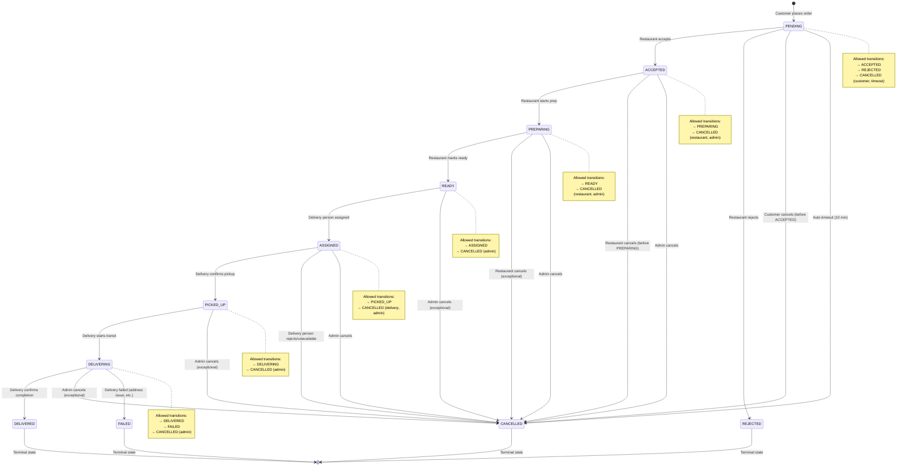
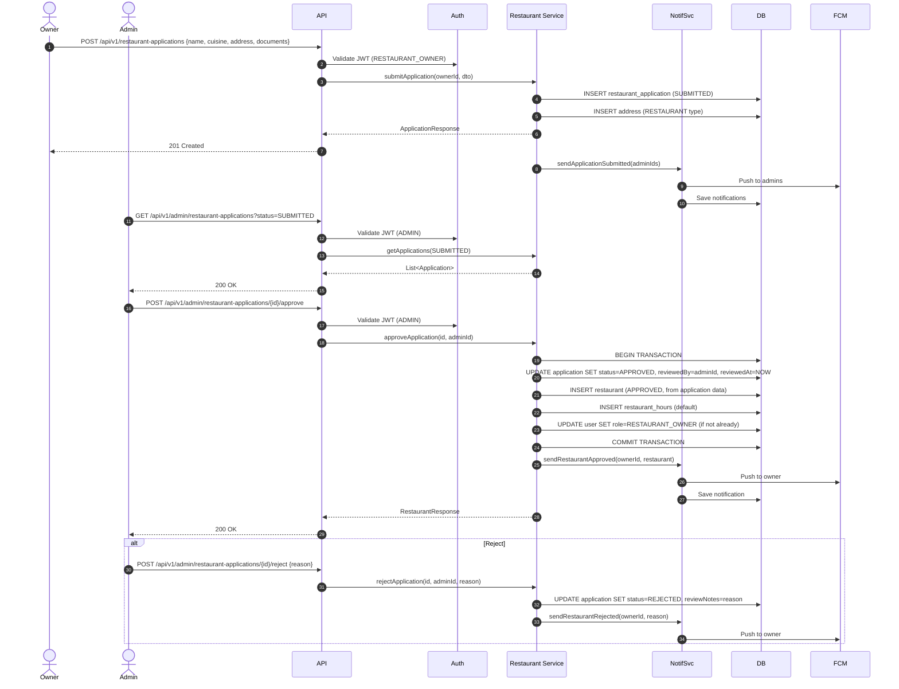
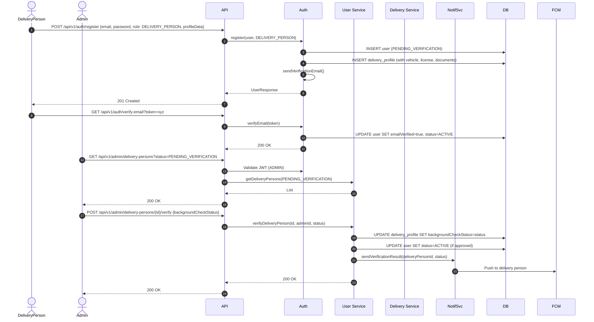
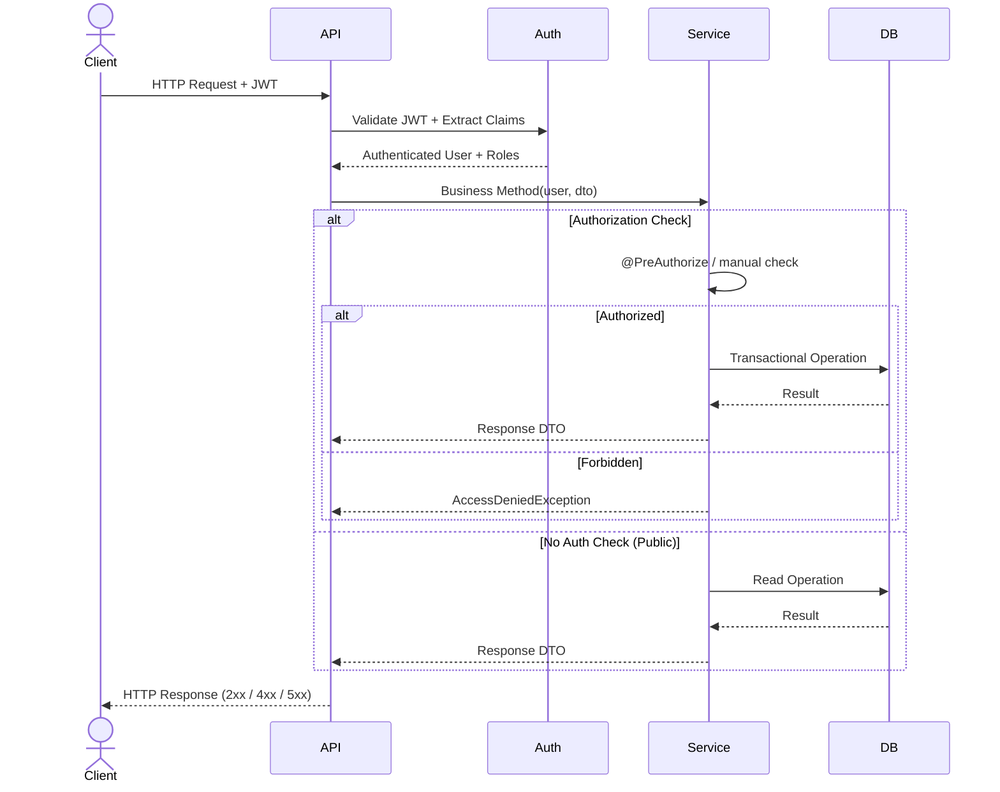
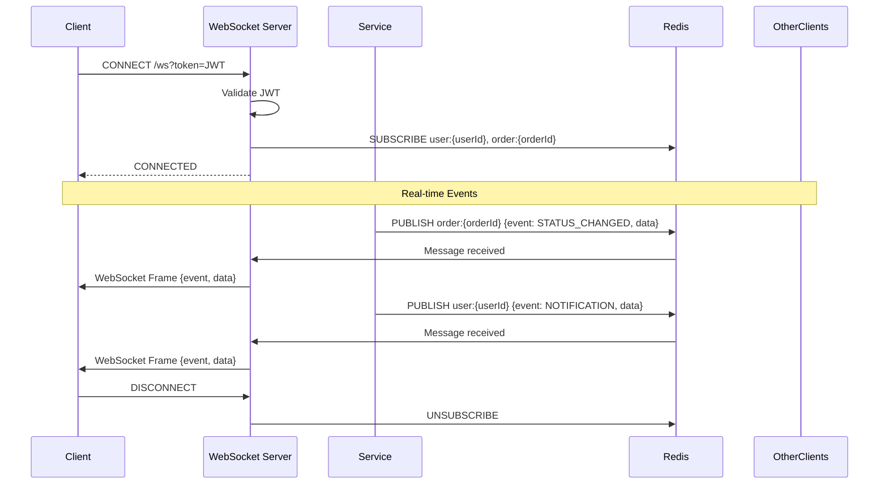

# UML Sequence Diagrams

## Project: Food Delivery Platform

**Version:** 1.0  
**Date:** 2026-11-19  
**Status:** PHASE 0 - Proposed (Pending Approval)

---

## 1. Complete Order Workflow Sequence Diagram

```mermaid
sequenceDiagram
    autonumber
    actor Customer
    actor Restaurant
    actor DeliveryPerson
    actor Admin
    participant API as API Gateway
    participant Auth as Auth Service
    participant OrderSvc as Order Service
    participant RestSvc as Restaurant Service
    participant DelivSvc as Delivery Service
    participant PaySvc as Payment Service
    participant NotifSvc as Notification Service
    participant DB as Database
    participant WS as WebSocket Server
    participant FCM as Firebase Cloud Messaging

    Note over Customer, FCM: ========== ORDER CREATION ==========
    
    Customer->>API: POST /api/v1/orders {items, addressId, idempotencyKey}
    API->>Auth: Validate JWT
    Auth-->>API: User (CUSTOMER)
    API->>OrderSvc: createOrder(customerId, dto)
    
    OrderSvc->>DB: BEGIN TRANSACTION
    OrderSvc->>DB: Validate restaurant APPROVED
    OrderSvc->>DB: Validate products exist, available, same restaurant
    OrderSvc->>DB: Calculate totals (subtotal, tax, deliveryFee, total)
    OrderSvc->>DB: INSERT order (PENDING)
    OrderSvc->>DB: INSERT order_items (with price snapshots)
    OrderSvc->>DB: INSERT payment (PENDING, COD)
    OrderSvc->>DB: INSERT order_status_history (PENDING)
    OrderSvc->>DB: COMMIT TRANSACTION
    
    OrderSvc-->>API: OrderResponse (orderId, orderNumber, status=PENDING)
    API-->>Customer: 201 Created
    
    par Notifications
        OrderSvc->>NotifSvc: sendOrderPlaced(customerId, order)
        NotifSvc->>FCM: Push to customer device
        NotifSvc->>DB: Save in-app notification
    and Restaurant Notification
        OrderSvc->>NotifSvc: sendNewOrder(restaurantOwnerId, order)
        NotifSvc->>FCM: Push to owner device
        NotifSvc->>WS: Broadcast to restaurant dashboard
        NotifSvc->>DB: Save in-app notification
    end

    Note over Customer, FCM: ========== RESTAURANT ACCEPTS/REJECTS ==========
    
    Restaurant->>API: POST /api/v1/restaurants/{id}/orders/{orderId}/accept
    API->>Auth: Validate JWT + ownership
    Auth-->>API: User (RESTAURANT_OWNER)
    API->>RestSvc: acceptOrder(restaurantId, orderId)
    
    RestSvc->>DB: BEGIN TRANSACTION
    RestSvc->>DB: Validate order.status = PENDING
    RestSvc->>DB: Validate order.restaurantId = restaurantId
    RestSvc->>DB: UPDATE order SET status=ACCEPTED, confirmedAt=NOW
    RestSvc->>DB: INSERT order_status_history (PENDING→ACCEPTED)
    RestSvc->>DB: COMMIT TRANSACTION
    
    RestSvc->>NotifSvc: sendOrderAccepted(customerId, order)
    NotifSvc->>FCM: Push to customer
    NotifSvc->>WS: Broadcast status update
    NotifSvc->>DB: Save notification
    
    RestSvc-->>API: OrderResponse (status=ACCEPTED)
    API-->>Restaurant: 200 OK
    
    alt Restaurant Rejects
        Restaurant->>API: POST /api/v1/restaurants/{id}/orders/{orderId}/reject {reason}
        API->>Auth: Validate JWT + ownership
        API->>RestSvc: rejectOrder(restaurantId, orderId, reason)
        
        RestSvc->>DB: BEGIN TRANSACTION
        RestSvc->>DB: UPDATE order SET status=REJECTED, cancelledAt=NOW, cancellationReason=reason
        RestSvc->>DB: INSERT order_status_history (PENDING→REJECTED)
        RestSvc->>DB: COMMIT TRANSACTION
        
        RestSvc->>NotifSvc: sendOrderRejected(customerId, order, reason)
        NotifSvc->>FCM: Push to customer
        NotifSvc->>WS: Broadcast status update
        
        RestSvc-->>API: OrderResponse (status=REJECTED)
        API-->>Restaurant: 200 OK
    end

    Note over Customer, FCM: ========== PREPARATION ==========
    
    Restaurant->>API: PATCH /api/v1/restaurants/{id}/orders/{orderId}/status {status: PREPARING}
    API->>RestSvc: updatePreparationStatus(restaurantId, orderId, PREPARING)
    RestSvc->>DB: UPDATE order SET status=PREPARING, preparingAt=NOW
    RestSvc->>DB: INSERT order_status_history (ACCEPTED→PREPARING)
    RestSvc->>NotifSvc: sendOrderPreparing(customerId, order)
    RestSvc-->>API: 200 OK
    
    Restaurant->>API: PATCH /api/v1/restaurants/{id}/orders/{orderId}/status {status: READY}
    API->>RestSvc: updatePreparationStatus(restaurantId, orderId, READY)
    RestSvc->>DB: UPDATE order SET status=READY, readyAt=NOW
    RestSvc->>DB: INSERT order_status_history (PREPARING→READY)
    RestSvc->>NotifSvc: sendOrderReady(customerId, order)
    RestSvc->>DelivSvc: notifyOrderReadyForPickup(orderId)
    RestSvc-->>API: 200 OK

    Note over Customer, FCM: ========== DELIVERY ASSIGNMENT ==========
    
    par Auto-Assignment (System)
        DelivSvc->>DB: Find available delivery persons near restaurant
        DelivSvc->>DB: SELECT * FROM delivery_profiles WHERE isAvailable=true AND distance < radius ORDER BY rating, workload
        DelivSvc->>DeliveryPerson: POST /api/v1/deliveries/offers {orderId, pickupAddr, deliveryAddr, estimatedEarnings}
        DeliveryPerson->>API: POST /api/v1/deliveries/offers/{offerId}/accept
        API->>DelivSvc: acceptOffer(deliveryPersonId, offerId)
        
        DelivSvc->>DB: BEGIN TRANSACTION
        DelivSvc->>DB: INSERT delivery (ASSIGNED, deliveryPersonId)
        DelivSvc->>DB: UPDATE order SET status=ASSIGNED
        DelivSvc->>DB: INSERT order_status_history (READY→ASSIGNED)
        DelivSvc->>DB: UPDATE delivery_profile SET isAvailable=false
        DelivSvc->>DB: COMMIT TRANSACTION
        
        DelivSvc->>NotifSvc: sendDeliveryAssigned(customerId, deliveryPersonId, order)
        DelivSvc->>NotifSvc: sendDeliveryAssigned(restaurantOwnerId, deliveryPersonId, order)
        NotifSvc->>FCM: Push to customer + delivery person + restaurant
        NotifSvc->>WS: Broadcast to all parties
    or Manual Assignment (Admin/Restaurant)
        Admin->>API: POST /api/v1/admin/deliveries/assign {orderId, deliveryPersonId}
        API->>DelivSvc: assignDelivery(orderId, deliveryPersonId)
        DelivSvc->>DB: (same transaction as above)
        DelivSvc->>DeliveryPerson: POST /api/v1/deliveries/offers/{offerId}/accept (timeout 60s)
    end

    Note over Customer, FCM: ========== PICKUP ==========
    
    DeliveryPerson->>API: POST /api/v1/deliveries/{deliveryId}/pickup {pickupCode, photoUrl?}
    API->>Auth: Validate JWT + delivery ownership
    API->>DelivSvc: confirmPickup(deliveryId, pickupCode, photoUrl)
    
    DelivSvc->>DB: BEGIN TRANSACTION
    DelivSvc->>DB: Validate delivery.status = ASSIGNED
    DelivSvc->>DB: Validate pickupCode matches
    DelivSvc->>DB: UPDATE delivery SET status=PICKED_UP, pickedUpAt=NOW, pickupPhotoUrl=photoUrl
    DelivSvc->>DB: UPDATE order SET status=PICKED_UP, pickedUpAt=NOW
    DelivSvc->>DB: INSERT order_status_history (ASSIGNED→PICKED_UP)
    DelivSvc->>DB: COMMIT TRANSACTION
    
    DelivSvc->>NotifSvc: sendDeliveryPickedUp(customerId, order)
    DelivSvc->>NotifSvc: sendDeliveryPickedUp(restaurantOwnerId, order)
    NotifSvc->>FCM: Push notifications
    NotifSvc->>WS: Broadcast status
    NotifSvc->>DB: Save notifications
    
    DelivSvc-->>API: DeliveryResponse (status=PICKED_UP)
    API-->>DeliveryPerson: 200 OK

    Note over Customer, FCM: ========== DELIVERY IN PROGRESS ==========
    
    loop Real-time Location Updates (every 10-30s)
        DeliveryPerson->>WS: WebSocket: location {lat, lng, accuracy, speed}
        WS->>DelivSvc: DeliveryLocationUpdate
        DelivSvc->>DB: INSERT delivery_location_updates
        WS->>Customer: WebSocket: delivery location update
        WS->>Restaurant: WebSocket: delivery location update
    end
    
    DeliveryPerson->>API: PATCH /api/v1/deliveries/{deliveryId}/status {status: DELIVERING}
    API->>DelivSvc: updateDeliveryStatus(deliveryId, DELIVERING)
    DelivSvc->>DB: UPDATE delivery SET status=DELIVERING
    DelivSvc->>NotifSvc: sendDeliveryDelivering(customerId, order)
    DelivSvc-->>API: 200 OK

    Note over Customer, FCM: ========== DELIVERY COMPLETION ==========
    
    DeliveryPerson->>API: POST /api/v1/deliveries/{deliveryId}/complete {deliveryCode, photoUrl?, signatureUrl?}
    API->>Auth: Validate JWT + delivery ownership
    API->>DelivSvc: confirmDelivery(deliveryId, deliveryCode, photoUrl, signatureUrl)
    
    DelivSvc->>DB: BEGIN TRANSACTION
    DelivSvc->>DB: Validate delivery.status IN (PICKED_UP, DELIVERING)
    DelivSvc->>DB: Validate deliveryCode matches
    DelivSvc->>DB: UPDATE delivery SET status=DELIVERED, deliveredAt=NOW, deliveryPhotoUrl=photoUrl, customerSignatureUrl=signatureUrl
    DelivSvc->>DB: UPDATE order SET status=DELIVERED, deliveredAt=NOW
    DelivSvc->>DB: INSERT order_status_history (PICKED_UP→DELIVERED)
    DelivSvc->>DB: UPDATE payment SET status=PAID, paidAt=NOW (COD)
    DelivSvc->>DB: UPDATE delivery_profile SET isAvailable=true, totalDeliveries=totalDeliveries+1
    DelivSvc->>DB: COMMIT TRANSACTION
    
    DelivSvc->>PaySvc: processCashOnDelivery(paymentId)
    PaySvc->>DB: UPDATE payment SET status=PAID, paidAt=NOW
    
    par Customer Notification
        DelivSvc->>NotifSvc: sendDeliveryDelivered(customerId, order)
        NotifSvc->>FCM: Push to customer
        NotifSvc->>WS: Broadcast DELIVERED
        NotifSvc->>DB: Save notification
    and Restaurant Notification
        DelivSvc->>NotifSvc: sendDeliveryDelivered(restaurantOwnerId, order)
        NotifSvc->>FCM: Push to owner
        NotifSvc->>WS: Broadcast DELIVERED
    and Delivery Person Notification
        DelivSvc->>NotifSvc: sendDeliveryCompleted(deliveryPersonId, earnings)
        NotifSvc->>FCM: Push to delivery person
    end
    
    DelivSvc-->>API: DeliveryResponse (status=DELIVERED)
    API-->>DeliveryPerson: 200 OK

    Note over Customer, FCM: ========== POST-DELIVERY ==========
    
    Customer->>API: POST /api/v1/reviews {orderId, targetType: RESTAURANT, rating, comment}
    API->>Auth: Validate JWT
    API->>ReviewSvc: createReview(customerId, dto)
    ReviewSvc->>DB: Validate order.status = DELIVERED
    ReviewSvc->>DB: Validate no existing review for this target
    ReviewSvc->>DB: INSERT review
    ReviewSvc->>DB: UPDATE restaurant SET averageRating, totalReviews
    ReviewSvc->>NotifSvc: sendReviewReceived(restaurantOwnerId, review)
    ReviewSvc-->>API: ReviewResponse
    API-->>Customer: 201 Created
```

---

## 2. Order State Machine Diagram



---

## 3. Restaurant Application Sequence



---

## 4. Delivery Person Onboarding Sequence



---

## 5. Key Sequence Diagram Patterns

### 5.1 Standard API Call Pattern



### 5.2 WebSocket Real-time Pattern



---

*These sequence diagrams define the critical workflows. All backend implementation must follow these interaction patterns.*