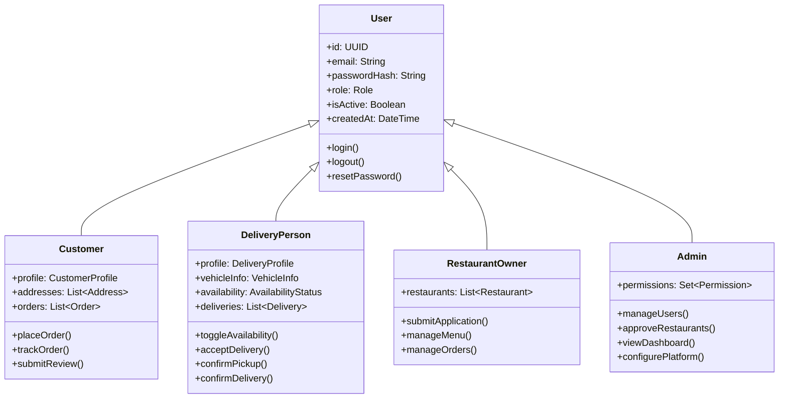

# UML Use Case Diagram

## Project: Food Delivery Platform

**Version:** 1.0  
**Date:** 2026-11-19  
**Status:** PHASE 0 - Proposed (Pending Approval)

---

## 1. Complete Use Case Diagram

```mermaid
useCaseDiagram
    left to right direction

    package "Food Delivery Platform" {
        actor Customer
        actor "Delivery Person"
        actor "Restaurant Owner"
        actor Admin
        actor "Anonymous User"

        package "Authentication & Access" {
            usecase "Register Account" as UC_AUTH_01
            usecase "Login / Logout" as UC_AUTH_02
            usecase "Email Verification" as UC_AUTH_03
            usecase "Password Reset" as UC_AUTH_04
            usecase "Manage Profile" as UC_AUTH_05
        }

        package "Restaurant Management" {
            usecase "Submit Restaurant Application" as UC_RST_01
            usecase "Approve/Reject Restaurant" as UC_RST_02
            usecase "Manage Restaurant Profile" as UC_RST_03
            usecase "Manage Opening Hours" as UC_RST_04
            usecase "View Restaurant Analytics" as UC_RST_05
            usecase "Browse Restaurants" as UC_RST_06
            usecase "Search Restaurants" as UC_RST_07
            usecase "View Restaurant Details" as UC_RST_08
            usecase "Suspend/Activate Restaurant" as UC_RST_09
        }

        package "Menu Management" {
            usecase "Manage Categories" as UC_CAT_01
            usecase "Manage Products" as UC_PRD_01
            usecase "Upload Product Images" as UC_PRD_02
            usecase "Toggle Product Availability" as UC_PRD_03
            usecase "View Menu" as UC_PRD_04
            usecase "Search Products" as UC_PRD_05
        }

        package "Address Management" {
            usecase "Manage Saved Addresses" as UC_ADR_01
            usecase "Set Default Address" as UC_ADR_02
        }

        package "Order Management" {
            usecase "Create Order" as UC_ORD_01
            usecase "Accept/Reject Order" as UC_ORD_02
            usecase "Update Preparation Status" as UC_ORD_03
            usecase "Track Order Status" as UC_ORD_04
            usecase "View Order History" as UC_ORD_05
            usecase "Cancel Order" as UC_ORD_06
            usecase "Reorder from History" as UC_ORD_07
            usecase "View All Orders (Admin)" as UC_ORD_08
            usecase "Assign Delivery (Admin)" as UC_ORD_09
        }

        package "Delivery Management" {
            usecase "Toggle Availability" as UC_DLV_01
            usecase "Accept/Reject Delivery Offer" as UC_DLV_02
            usecase "Confirm Pickup" as UC_DLV_03
            usecase "Confirm Delivery" as UC_DLV_04
            usecase "Track Delivery Location" as UC_DLV_05
            usecase "View Delivery History" as UC_DLV_06
            usecase "View Earnings" as UC_DLV_07
        }

        package "Payment Management" {
            usecase "Process Cash on Delivery" as UC_PAY_01
            usecase "View Payment Status" as UC_PAY_02
            usecase "Initiate Refund" as UC_PAY_03
        }

        package "Notifications" {
            usecase "Receive Push Notifications" as UC_NOT_01
            usecase "Receive Email Notifications" as UC_NOT_02
            usecase "View Notification Center" as UC_NOT_03
            usecase "Manage Notification Preferences" as UC_NOT_04
        }

        package "Reviews & Ratings" {
            usecase "Submit Review" as UC_REV_01
            usecase "Respond to Review" as UC_REV_02
            usecase "View Reviews" as UC_REV_03
            usecase "Moderate Reviews (Admin)" as UC_REV_04
        }

        package "Administration" {
            usecase "View Dashboard KPIs" as UC_ADM_01
            usecase "Manage Users" as UC_ADM_02
            usecase "Manage Delivery Persons" as UC_ADM_03
            usecase "Monitor Orders" as UC_ADM_04
            usecase "View Global Statistics" as UC_ADM_05
            usecase "Configure Platform Settings" as UC_ADM_06
            usecase "Audit Logs" as UC_ADM_07
        }
    }

    %% Customer relationships
    Customer --> UC_AUTH_01
    Customer --> UC_AUTH_02
    Customer --> UC_AUTH_03
    Customer --> UC_AUTH_04
    Customer --> UC_AUTH_05
    Customer --> UC_RST_06
    Customer --> UC_RST_07
    Customer --> UC_RST_08
    Customer --> UC_PRD_04
    Customer --> UC_PRD_05
    Customer --> UC_ADR_01
    Customer --> UC_ADR_02
    Customer --> UC_ORD_01
    Customer --> UC_ORD_04
    Customer --> UC_ORD_05
    Customer --> UC_ORD_06
    Customer --> UC_ORD_07
    Customer --> UC_PAY_02
    Customer --> UC_NOT_01
    Customer --> UC_NOT_02
    Customer --> UC_NOT_03
    Customer --> UC_NOT_04
    Customer --> UC_REV_01
    Customer --> UC_REV_03

    %% Delivery Person relationships
    "Delivery Person" --> UC_AUTH_01
    "Delivery Person" --> UC_AUTH_02
    "Delivery Person" --> UC_AUTH_03
    "Delivery Person" --> UC_AUTH_04
    "Delivery Person" --> UC_AUTH_05
    "Delivery Person" --> UC_DLV_01
    "Delivery Person" --> UC_DLV_02
    "Delivery Person" --> UC_DLV_03
    "Delivery Person" --> UC_DLV_04
    "Delivery Person" --> UC_DLV_05
    "Delivery Person" --> UC_DLV_06
    "Delivery Person" --> UC_DLV_07
    "Delivery Person" --> UC_NOT_01
    "Delivery Person" --> UC_NOT_02
    "Delivery Person" --> UC_NOT_03
    "Delivery Person" --> UC_NOT_04
    "Delivery Person" --> UC_REV_03

    %% Restaurant Owner relationships
    "Restaurant Owner" --> UC_AUTH_01
    "Restaurant Owner" --> UC_AUTH_02
    "Restaurant Owner" --> UC_AUTH_03
    "Restaurant Owner" --> UC_AUTH_04
    "Restaurant Owner" --> UC_AUTH_05
    "Restaurant Owner" --> UC_RST_01
    "Restaurant Owner" --> UC_RST_03
    "Restaurant Owner" --> UC_RST_04
    "Restaurant Owner" --> UC_RST_05
    "Restaurant Owner" --> UC_CAT_01
    "Restaurant Owner" --> UC_PRD_01
    "Restaurant Owner" --> UC_PRD_02
    "Restaurant Owner" --> UC_PRD_03
    "Restaurant Owner" --> UC_ORD_02
    "Restaurant Owner" --> UC_ORD_03
    "Restaurant Owner" --> UC_ORD_05
    "Restaurant Owner" --> UC_PAY_02
    "Restaurant Owner" --> UC_PAY_03
    "Restaurant Owner" --> UC_NOT_01
    "Restaurant Owner" --> UC_NOT_02
    "Restaurant Owner" --> UC_NOT_03
    "Restaurant Owner" --> UC_NOT_04
    "Restaurant Owner" --> UC_REV_02
    "Restaurant Owner" --> UC_REV_03

    %% Admin relationships
    Admin --> UC_AUTH_02
    Admin --> UC_AUTH_05
    Admin --> UC_RST_02
    Admin --> UC_RST_09
    Admin --> UC_ORD_08
    Admin --> UC_ORD_09
    Admin --> UC_DLV_06
    Admin --> UC_PAY_03
    Admin --> UC_REV_04
    Admin --> UC_ADM_01
    Admin --> UC_ADM_02
    Admin --> UC_ADM_03
    Admin --> UC_ADM_04
    Admin --> UC_ADM_05
    Admin --> UC_ADM_06
    Admin --> UC_ADM_07

    %% Anonymous User relationships
    "Anonymous User" --> UC_RST_06
    "Anonymous User" --> UC_RST_07
    "Anonymous User" --> UC_RST_08
    "Anonymous User" --> UC_PRD_04
    "Anonymous User" --> UC_AUTH_01
    "Anonymous User" --> UC_AUTH_03
    "Anonymous User" --> UC_AUTH_04

    %% Include/Extend relationships
    UC_ORD_01 ..> UC_ADR_01 : <<include>>
    UC_ORD_01 ..> UC_PAY_01 : <<include>>
    UC_ORD_02 ..> UC_NOT_01 : <<include>>
    UC_ORD_03 ..> UC_NOT_01 : <<include>>
    UC_DLV_03 ..> UC_NOT_01 : <<include>>
    UC_DLV_04 ..> UC_NOT_01 : <<include>>
    UC_DLV_04 ..> UC_PAY_01 : <<include>>
    UC_REV_01 ..> UC_NOT_01 : <<include>>
    UC_RST_02 ..> UC_NOT_01 : <<include>>
    UC_ADM_02 ..> UC_NOT_02 : <<include>>

    UC_ORD_06 .> UC_ORD_01 : <<extend>> (cancellation rules)
    UC_ORD_07 .> UC_ORD_05 : <<extend>>
    UC_PAY_03 .> UC_PAY_01 : <<extend>>
```

---

## 2. Use Case Details

### 2.1 Customer Use Cases

| Use Case | Description | Preconditions | Postconditions |
|----------|-------------|---------------|----------------|
| **Browse Restaurants** | View list of approved restaurants with filters | None | Restaurant list displayed |
| **View Restaurant Details** | See menu, hours, reviews, contact info | Restaurant is APPROVED | Details page shown |
| **Manage Cart** | Add/remove/update items from single restaurant | Restaurant selected | Cart updated |
| **Place Order** | Submit order with address, payment (COD) | Cart not empty, address selected | Order created (PENDING) |
| **Track Order** | Real-time status updates | Order exists | Status + delivery tracking shown |
| **View Order History** | Paginated, filterable past orders | Authenticated | Order list displayed |
| **Submit Review** | Rate restaurant/delivery (1-5 stars + comment) | Order DELIVERED, no existing review | Review saved, aggregates updated |

### 2.2 Delivery Person Use Cases

| Use Case | Description | Preconditions | Postconditions |
|----------|-------------|---------------|----------------|
| **Toggle Availability** | Go online/offline for delivery offers | Approved delivery person | Availability status changed |
| **Accept/Reject Offer** | Respond to delivery assignment (60s timeout) | Offer received, AVAILABLE | Delivery assigned or re-queued |
| **Confirm Pickup** | Verify pickup with code/photo | Delivery ASSIGNED, at restaurant | Status → PICKED_UP |
| **Confirm Delivery** | Verify delivery with code/photo/signature | Delivery PICKED_UP, at customer | Status → DELIVERED, payment collected |

### 2.3 Restaurant Owner Use Cases

| Use Case | Description | Preconditions | Postconditions |
|----------|-------------|---------------|----------------|
| **Submit Application** | Apply to join platform | Registered as owner | Application PENDING_APPROVAL |
| **Manage Menu** | CRUD categories & products | Restaurant APPROVED | Menu updated |
| **Accept/Reject Order** | Respond to new order | Order PENDING | Order ACCEPTED or REJECTED |
| **Update Preparation** | PREPARING → READY | Order ACCEPTED | Status updated, customer notified |

### 2.4 Admin Use Cases

| Use Case | Description | Preconditions | Postconditions |
|----------|-------------|---------------|----------------|
| **Approve Restaurant** | Review application, approve/reject | Application submitted | Restaurant APPROVED/REJECTED |
| **Manage Users** | Activate/deactivate, change roles | Admin authenticated | User updated |
| **Assign Delivery** | Manual override of auto-assignment | Order READY, delivery person available | Delivery created, assigned |
| **View Dashboard** | KPIs: orders, revenue, users, ratings | Admin authenticated | Metrics displayed |

---

## 3. Use Case Relationships

### Include Relationships (Mandatory)
- `Place Order` **includes** `Select Address` + `Process Payment`
- `Accept Order` **includes** `Send Notification`
- `Confirm Delivery` **includes** `Process Payment` + `Send Notification`
- `Submit Review` **includes** `Send Notification`
- `Approve Restaurant` **includes** `Send Notification`

### Extend Relationships (Optional)
- `Cancel Order` **extends** `Place Order` (with cancellation rules)
- `Reorder` **extends** `View Order History`
- `Refund` **extends** `Process Payment`

---

## 4. System Boundary Context Diagram

```mermaid
graph TB
    subgraph "External Actors"
        Customer
        DeliveryPerson[Delivery Person]
        RestaurantOwner[Restaurant Owner]
        Admin
        Anonymous[Anonymous User]
        PaymentGateway[Payment Gateway\n(Future)]
        MapService[Map/Geolocation Service]
        EmailProvider[Email Provider]
        SMSProvider[SMS Provider]
        FCM[Firebase Cloud Messaging]
    end

    subgraph "Food Delivery Platform"
        Platform[Platform Core]
    end

    Customer --> Platform
    DeliveryPerson --> Platform
    RestaurantOwner --> Platform
    Admin --> Platform
    Anonymous --> Platform

    Platform --> PaymentGateway
    Platform --> MapService
    Platform --> EmailProvider
    Platform --> SMSProvider
    Platform --> FCM
```

---

## 5. Actor Generalization



---

*This use case diagram defines the functional scope. All implementation must trace to these use cases.*